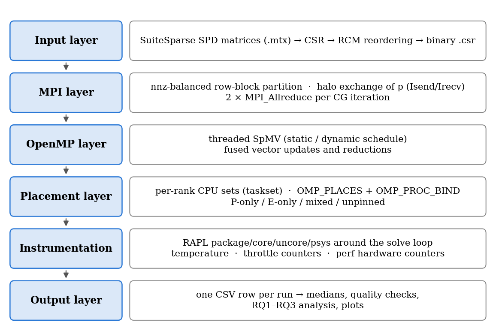
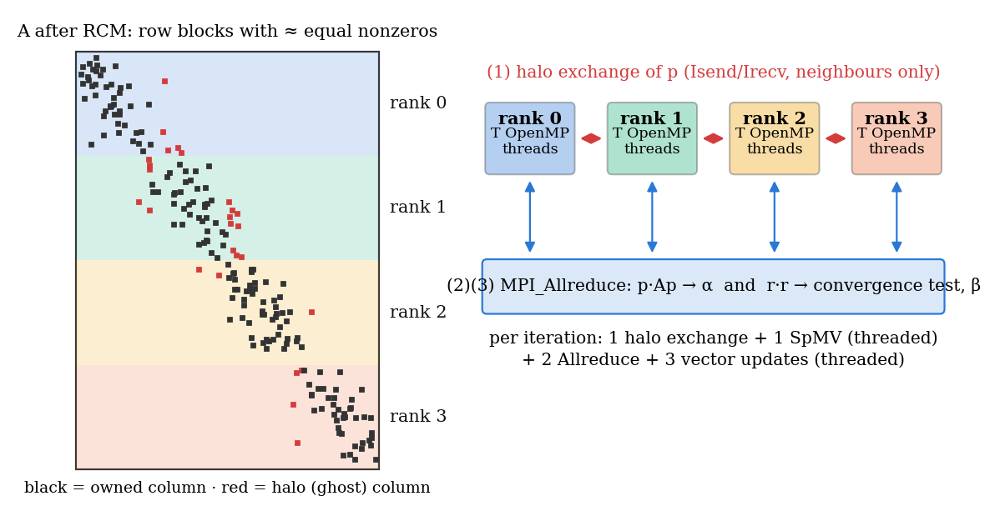
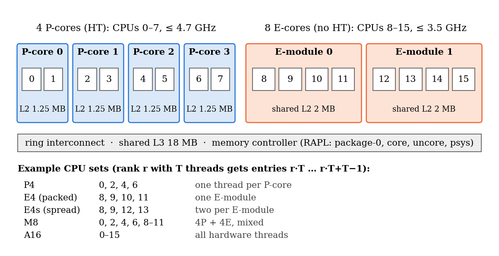
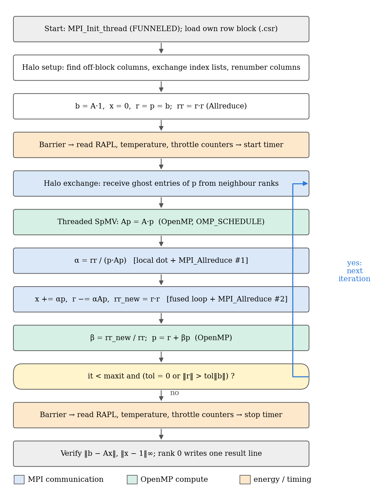
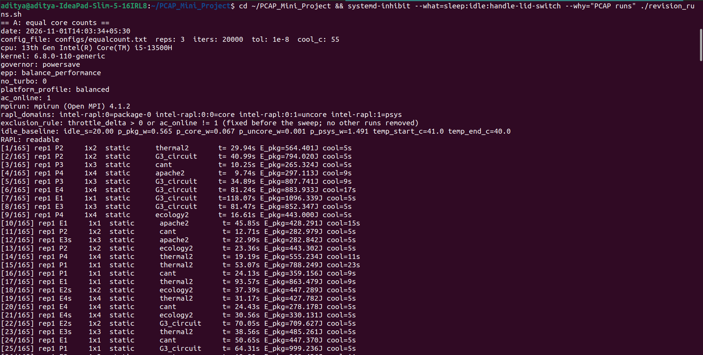
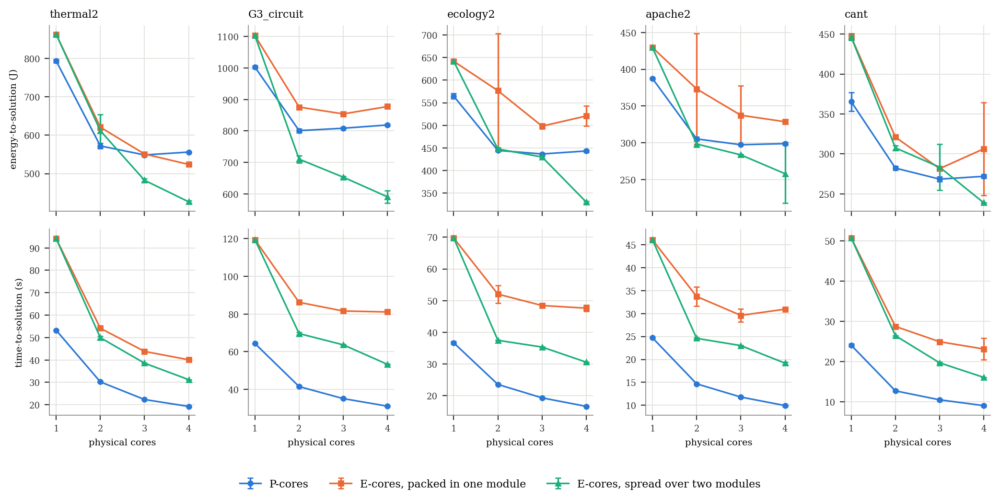
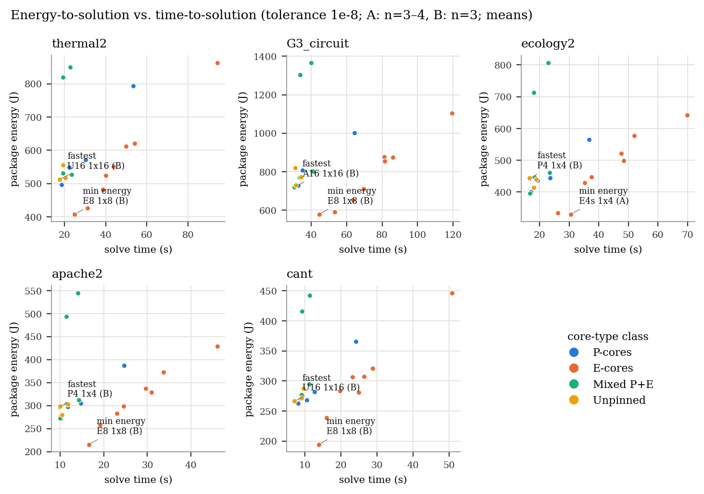
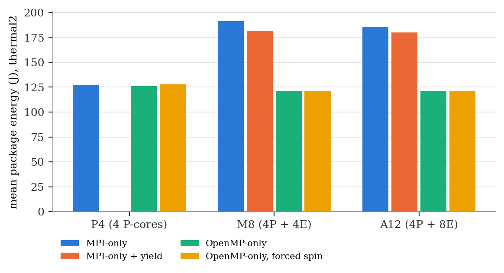
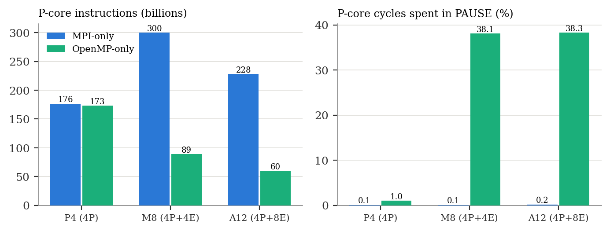

<!--
=====================================================================
FORMATTING INSTRUCTIONS FOR CLAUDE (WINDOWS) — read first, do not include in the document
=====================================================================
Build a .docx from this Markdown, following the department "Final Project Report Template".
Everything after this comment is document content. Keep chapter order and numbering exactly.

Page & text
- A4 portrait. Margins: LEFT 1.5 in (binding), top/bottom/right 1 in.
- Times New Roman everywhere. Body 12 pt, line spacing 1.5, justified. Black text only.
- Chapter headings ("# Chapter N: ...") 14 pt bold, each chapter starts on a new page.
- Section headings ("## N.M ...") 12 pt bold. Sub-sections ("### ...") 12 pt bold italic.
- Page numbers bottom centre: Roman (i, ii, iii …) for front matter (title page unnumbered),
  Arabic (1, 2, 3 …) starting at Chapter 1.

Front matter (in this order)
1. Title page — centred; content under "TITLE PAGE". Insert the MIT Manipal logo where marked
   (the team will supply the image). Keep any [bracketed placeholders] highlighted yellow.
2. Abstract — one paragraph, then the "Keywords:" line.
3. Table of contents, List of figures, List of tables (Word auto-generated fields from heading styles and
   captions), then the List of abbreviations table given below.

Figures and tables
- Numbered by chapter exactly as written (Figure 4.1, Table 6.2). Captions: BELOW figures, ABOVE tables,
  11 pt, with "Figure 4.1:" / "Table 6.2:" in bold. Every figure/table is already cited in the text.
- "" → insert that PNG from the figures/ folder, centred, width 6 in
  (flowchart: 4.5 in). The alt text is the caption.
- Tables: 10.5 pt, single spacing, thin black borders, header row bold with D9D9D9 shading,
  numbers right-aligned, autofit to page width.

Equations
- Lines written as "EQUATION (3.1): …" → a centred equation (Word equation editor) with "(3.1)"
  right-aligned on the same line. Remove the word "EQUATION".

Code and pseudocode
- Fenced blocks → Consolas 9.5 pt, single spacing, inside a one-cell bordered table shaded F2F2F2.
  The line above each block ("Algorithm 1: …" or "Code Snippet 5.1: …") is its caption, 11 pt bold.

References
- IEEE style, numbered in order of first citation (already numbered — keep). 11 pt, hanging indent 0.25 in.

Placeholders
- Complete the title-page details before submission.
- "[bracketed text]" on the title page = team details to fill; highlight yellow.

Appendix A
- Insert the full source files listed in Appendix A (from the GitHub repository) as code listings.
=====================================================================
BEGIN REPORT
=====================================================================
-->

# TITLE PAGE

[MIT Manipal logo]

**Energy-Performance Characterization of Hybrid MPI+OpenMP Sparse Iterative Solvers on Heterogeneous P-core/E-core Processors**

Parallel Computing Lab Mini-Project Report

Submitted by

Javvaji Aditya Banasri (Reg. No. 240962478)

Bollavaram Shashank Reddy (Reg. No. 240962516)

[B.Tech, Computer Science and Engineering, Semester —]

Under the guidance of

[Guide name, designation]

Department of Computer Science and Engineering

Manipal Institute of Technology, Manipal Academy of Higher Education, Manipal

[Month Year]

---

# Abstract

Modern x86 processors combine fast performance cores (P-cores) with smaller efficiency cores (E-cores), but parallel scientific codes are still tuned as if all cores were alike. This project studies how this heterogeneity affects the runtime and energy of a hybrid MPI+OpenMP Conjugate Gradient (CG) solver for sparse symmetric positive-definite systems on an Intel Core i5-13500H, which has 4 Hyper-Threaded P-cores and 8 E-cores. We implemented the solver with a nonzero-balanced row-block decomposition, halo exchange and threaded sparse matrix-vector products. We applied Reverse Cuthill–McKee reordering and measured energy with Intel RAPL package counters, read once per run between barriers. Five SuiteSparse matrices were solved, without a preconditioner, to the same relative-residual tolerance of 10⁻⁸ in randomised repeated runs (three per group in Experiment B; three or four in Experiment A), with solution accuracy verified for every run. At equal physical core counts (one to four cores), P-cores are faster in every matched comparison, while four spread E-cores save 12.2–27.9% package energy versus four P-cores at 1.62–1.93× the runtime. Across the observed means in Experiments A and B, the fastest and the most energy-efficient configurations differ on every matrix: the fastest observed mean uses 1.24–1.37× the energy of the minimum-energy configuration, which takes 1.42–1.95× as long. A 51-configuration survey with 765 runs and hardware performance counters showed that pure MPI on mixed P+E cores uses 1.5–1.8× more energy than OpenMP at the same runtime. The cause is waiting P-core ranks busy-polling MPI's shared-memory queues with little PAUSE activity; OpenMP runs instead spend about 38% of measured P-core cycles in PAUSE. Core type, core placement and the MPI/OpenMP split are therefore energy decisions on heterogeneous processors, not only performance decisions.

**Keywords:** hybrid MPI+OpenMP; Conjugate Gradient; heterogeneous processors; P-cores and E-cores; energy efficiency; Intel RAPL

---

# Table of Contents

[Insert automatic table of contents]

# List of Figures

[Insert automatic list of figures]

# List of Tables

[Insert automatic list of tables]

# List of Abbreviations

| Abbreviation | Meaning |
|---|---|
| CG | Conjugate Gradient |
| CSR | Compressed Sparse Row |
| CV | Coefficient of variation (SD / mean) |
| DVFS | Dynamic Voltage and Frequency Scaling |
| E-core | Efficiency core |
| EPP | Energy-Performance Preference |
| HT | Hyper-Threading |
| IPC | Instructions per cycle |
| MPI | Message Passing Interface |
| nnz | Number of nonzero entries |
| OpenMP | Open Multi-Processing |
| P-core | Performance core |
| RAPL | Running Average Power Limit (Intel energy counters) |
| RCM | Reverse Cuthill–McKee |
| SD | Standard deviation |
| SpMV | Sparse matrix-vector multiplication |
| SPD | Symmetric positive-definite |

---

# Chapter 1: Problem Statement

## 1.1 Background

Since Intel's 12th-generation (Alder Lake) processors, mainstream x86 chips combine two kinds of cores in one package [1]. Performance cores (P-cores) are wide, Hyper-Threaded and clocked high. Efficiency cores (E-cores) are smaller, single-threaded, lower-clocked, and grouped into modules of four. On the Intel Core i5-13500H used in this project, each four-core E-module shares one 2 MB L2 cache, while each P-core has its own 1.25 MB L2 (verified on the machine, Section 6.1). The operating system has to decide which kind of core runs each thread. The Linux Energy-Aware Scheduler, which makes such decisions on Arm big.LITTLE systems, is not used on x86 hybrid processors: turbo frequency ranges, inter-CPU dependencies, simultaneous multithreading and instruction-specific throughput differences make it hard to give the scheduler an accurate model of core capacity [2].

The Conjugate Gradient (CG) method [3] is the standard iterative solver for large sparse symmetric positive-definite (SPD) linear systems *Ax = b*, which arise in structural analysis, heat transfer, circuit simulation and many other simulations. Each CG iteration is dominated by a sparse matrix-vector multiplication (SpMV). SpMV is limited mainly by memory bandwidth and accesses the vector irregularly. Large sparse solvers are normally parallelised in a *hybrid* way: MPI processes (ranks) own blocks of rows and exchange boundary data, and OpenMP threads share the work inside each process.

Key terms used in this report:
- A **configuration** is the number of MPI ranks × OpenMP threads per rank (written R×T), the set of CPUs they are pinned to, and the OpenMP loop schedule.
- **Energy-to-solution** is the processor-package energy, read from the RAPL counters, consumed while solving one system to the required tolerance.

## 1.2 Motivation

Energy, not only speed, is now a design constraint for parallel software, and the two are known to disagree:
- **On homogeneous clusters:** Lively et al. found that the best CPU frequency for energy was not the best for execution time [4]. Wlotzka and Heuveline found that, for large host systems, a hybrid MPI+OpenMP multigrid solver was the most energy-efficient option although not the fastest [5].
- **On heterogeneous processors** the trade-off is sharper and less predictable. Żytko and Badurowicz measured P-cores of Intel 12th/13th-generation processors as 1.3–3.2× faster than E-cores. Yet E-cores were up to 17% more energy-efficient on memory-intensive tasks, and P-cores up to 2.1× more efficient on floating-point-intensive tasks [6].

Sparse CG is memory-bound but still does floating-point work, so it sits between these two categories, and which core type serves it better cannot be predicted from these results. The laptop and desktop processors that students and engineers use for simulation are now all of this hybrid type, so the question affects ordinary users of parallel solvers, not only data centres. This motivates three research questions:
- **RQ1.** Does the configuration that minimises runtime also minimise energy-to-solution?
- **RQ2.** At equal physical core counts (1–4), do P-cores or E-cores give lower energy-to-solution for memory-bound sparse CG, and does the answer depend on the matrix?
- **RQ3.** Does the default Linux scheduler, without pinning, match the best pinned configuration in runtime and in energy?

## 1.3 Limitations of Existing Solutions

Table 1.1 summarises the main existing approaches and why none of them answers these questions.

Table 1.1: Existing approaches and their limitations for this problem.

| Existing approach / system | What it does | Limitation |
|---|---|---|
| Hybrid MPI+OpenMP sparse CG and SpMV studies [7], [8], [9] | Compare pure MPI with hybrid MPI+OpenMP for sparse CG/SpMV; tune the process×thread allocation for runtime | Runtime only; homogeneous cores |
| Energy studies of MPI vs hybrid applications [4], [5], [10] | Measure or reduce energy-to-solution of MPI-only and hybrid codes (frequency scaling, concurrency throttling) | Homogeneous server processors; no core-type dimension |
| Hybrid-CPU workload characterisation [6], [11] | Measure P-core vs E-core speed and efficiency (microbenchmarks) and OpenMP thread scaling across P/E cores | Microbenchmarks or OpenMP-only runtime; no MPI, no sparse-solver energy |
| OS-level heterogeneous resource managers [12], [13] | Allocate cores to OpenMP/TBB/TensorFlow applications to save time and energy | Operating-system level; MPI+OpenMP solvers not evaluated |
| Default Linux scheduling on hybrid x86 [2] | Places threads using core-capacity hints | Energy-aware scheduling is not used on x86 hybrid processors |

## 1.4 Problem Statement

To design and implement an energy-instrumented hybrid MPI+OpenMP Conjugate Gradient solver for sparse SPD matrices on a heterogeneous P-core/E-core processor, so that the time- and energy-to-solution of every process×thread split, core-type placement and scheduling policy can be measured reproducibly (run-to-run variation below 2%) and compared at equal core counts. This overcomes the main limitation of existing work, which evaluates either homogeneous hardware or OpenMP-only and microbenchmark workloads (Table 1.1).

## 1.5 Scope of the Project

- **In scope:** unpreconditioned CG on five SuiteSparse SPD matrices; MPI+OpenMP parallelism within one processor; P-only, E-only, mixed and unpinned placements; static and dynamic OpenMP schedules; processor-package energy via RAPL; hardware performance counters for one follow-up experiment.
- **Out of scope:** preconditioners; multi-node clusters and network communication; GPUs; NUMA effects (single socket); whole-system and DRAM energy (this processor has no DRAM RAPL domain); changing CPU frequency or power limits.
- **Assumptions and constraints:** one laptop (Intel Core i5-13500H, 16 GB RAM, native Ubuntu 22.04) on AC power with fixed default power settings. RAPL readings are used only to compare configurations measured with the same instrument [14].

---

# Chapter 2: Objectives

1. **O1:** To implement and validate a hybrid MPI+OpenMP CG solver (row-block MPI decomposition, halo exchange, OpenMP-threaded SpMV) that converges every test matrix to a true relative residual ≤ 10⁻⁸ in every configuration.
2. **O2:** To develop a measurement harness that records time-to-solution and processor-package energy (RAPL, measured once per run between barriers), with pinning, thermal control, pre-defined exclusion rules and randomised repeated runs, achieving run-to-run variation (CV) below 2% for pinned configurations.
3. **O3:** To evaluate P-core-only versus E-core-only execution at equal physical core counts of 1–4, and mixed/full-chip configurations separately, on five SuiteSparse SPD matrices, reporting time- and energy-to-solution as mean ± SD over repeated runs, with actual sample counts disclosed.
4. **O4:** To compare the runtime-optimal and energy-optimal configurations (RQ1), the core types (RQ2) and the default scheduler versus pinning (RQ3), quantifying each difference as a time ratio and an energy ratio, and to explain the mechanism behind any unexpected energy difference.

Table 2.1 maps each objective to the section where its result is reported.

Table 2.1: Objective–outcome mapping.

| Objective | Where it is addressed | Achieved? (Yes / Partly / No) |
|---|---|---|
| O1 | Sections 5.2, 5.5, 6.3.1 | Yes — all 348 A/B runs satisfy the true-residual tolerance |
| O2 | Sections 3.6, 5.2.4, 6.1, 6.3 | Partly — instrumentation complete; some pinned groups exceed the 2% CV target |
| O3 | Sections 6.3.2, 6.3.3, 7.1 | Yes — 55 matrix/configuration groups in each experiment, with actual sample counts reported |
| O4 | Sections 6.3.4, 6.3.5, 7.1, 7.2 | Yes |

---

# Chapter 3: Methodology

## 3.1 Literature Survey Summary

The literature falls into four groups:
- **Hybrid MPI+OpenMP sparse solvers, runtime only.** Oliker et al. found that a hybrid MPI+OpenMP paradigm for CG increases programming complexity with little performance gain [7]. Schubert et al. found that hybrid SpMV can still help through better load balancing [8]. Nakajima showed that the process/thread allocation changes solver performance by about 10–20% [9].
- **Energy of MPI versus hybrid codes, all on homogeneous processors** [4], [5], [10], [15].
- **Heterogeneous P/E processors:** microbenchmarks [6], OpenMP-only thread scaling [11] and operating-system resource managers [12], [13].
- **Energy measurement:** work on the accuracy and pitfalls of RAPL and software power meters [16], [17], [18], [14], which shapes our measurement design.

Table 3.1 summarises the method, setting, key result and gap of each reviewed work.

Table 3.1: Literature survey summary (results as stated in each paper's abstract).

| Ref | Author(s), year | Method used | Dataset / setting | Key result | Gap identified |
|---|---|---|---|---|---|
| [6] | Żytko & Badurowicz, 2025 | P-core vs E-core benchmarking of performance and energy efficiency | Intel 12th/13th-gen desktop and mobile CPUs, microbenchmarks | P-cores 1.3–3.2× faster; E-cores up to 17% more energy-efficient (memory-intensive); P-cores up to 2.1× more efficient (FP-intensive) | Microbenchmarks only; no parallel solver |
| [11] | Velugoti et al., 2026 | Thread-scaling study of hybrid cores and hybrid L2 | Alder Lake; miniVite, NAS SP/BT/LU/FT, CRONO, PARSEC (OpenMP) | Imbalanced workloads scale better with thread affinity disabled; hybrid L2 has little effect on most shared-data workloads | OpenMP only; runtime only; no MPI, no energy |
| [12] | Smejkal et al., 2024 (E-Mapper) | Linux-integrated resource manager using application descriptions | Intel Raptor Lake and Arm big.LITTLE; OpenMP, TBB, TensorFlow | Execution time −20% and energy −34% on average | OS level; MPI+OpenMP solvers not evaluated |
| [13] | Smejkal et al., 2025 (HARP) | Adaptive heterogeneous resource management with an application–manager interface | Two heterogeneous systems; OpenMP, TBB, custom models | Execution time −12% and energy −28% versus existing methods | As [12] |
| [9] | Nakajima, 2025 | Process/thread allocation (12×4, 6×8, 3×16) for communication–computation overlap in multigrid-preconditioned CG | Wisteria/BDEC-01 Odyssey (A64FX), up to 4096 nodes | 3×16 and 6×8 better for small problems; fewer threads per process ≈10–20% faster at small sizes | No energy; homogeneous cores |
| [19] | Milyukova, 2023 | MPI vs MPI+OpenMP IC(0)-preconditioned CG with grid-node reordering | Model problems and SuiteSparse matrices | Comparative timings of MPI and MPI+OpenMP preconditioner variants | Runtime only |
| [18] | Raffin & Trystram, 2025 | Critical analysis of RAPL access mechanisms (MSR, powercap, perf-events, eBPF) | Multiple benchmarks and processor models | Documents measurement pitfalls in existing tools; provides a corrected implementation | Measurement method, not solver behaviour |
| [16] | Ostapenco et al., 2025 | RAPL power capping validated with a high-precision external power meter | Heterogeneous server nodes; CPU- and memory-intensive workloads | Characterises capping accuracy, power-limit granularity and settling time | Capping on servers; no hybrid P/E CPU |
| [17] | Jay et al., 2023 | Comparison of software-based power meters against physical meters | CPU- and GPU-intensive workloads | Strengths and limitations of each software power meter | Measurement only |
| [14] | Lastovetsky & Manumachu, 2023 | Review of bi-objective energy/performance optimisation and of energy-measurement methods | Heterogeneous HPC platforms (CPU + GPU) | Accuracy/performance trade-offs of the three main component-level measurement methods | No P/E-core solver study |
| [20] | Iakymchuk et al., 2020 | Reproducible PCG in hybrid MPI + OpenMP tasks | Two HPC systems, up to 768 cores | Reproducible iterations and residuals at < 37.7% overhead | Accuracy, not energy |
| [5] | Wlotzka & Heuveline, 2017 | Time and energy to solution of multigrid smoothers: MPI-only, MPI+OpenMP, GPU | Multi-core and GPU clusters | For large host systems hybrid MPI+OpenMP is most energy-beneficial, though not fastest | Homogeneous CPUs |
| [4] | Lively et al., 2011 | MPI-only vs hybrid MPI/OpenMP, with CPU frequency scaling | NAS BT, Lattice Boltzmann, GTC; 8 nodes × 4 cores, power-instrumented | ≤ 16 cores: best version application-dependent; 32 cores: hybrid lower time and energy; best frequency for energy ≠ best for time | Homogeneous cores |
| [10] | Li et al., 2010 | Power-aware hybrid MPI/OpenMP runtime (DVFS + concurrency throttling) | ASC Sequoia and NPB-MZ benchmarks | 4.18% average (up to 13.8%) energy saving with negligible loss or up to 7.2% gain | Homogeneous cores |
| [8] | Schubert et al., 2011 | Pure MPI vs hybrid SpMV; explicit overlap with a communication thread | Multicore cluster and Cray XE6 | Nonblocking MPI does not hide communication; hybrid helps through load balancing | No energy |
| [7] | Oliker et al., 2002 | Orderings and paradigms (MPI, shared memory, hybrid) for CG and ILU(0)-PCG | Distributed and distributed-shared-memory systems; Cray MTA | Ordering improves performance; hybrid MPI+OpenMP adds complexity with little gain | Runtime only |

Of these sixteen works, ten are from the last five years ([6], [9], [11], [12], [13], [19], [16], [17], [18], [14]). The older ones are cited as foundational evidence for the hybrid-versus-MPI and energy-versus-runtime questions.

**Gap.** None of the reviewed studies (Table 3.1) measures the energy-to-solution of a hybrid MPI+OpenMP sparse iterative solver across process×thread splits and core-type placements on a heterogeneous P-core/E-core processor. None tests whether the E-core energy advantage reported for memory-intensive microbenchmarks [6] carries over to such a solver. The nearest work [11] covers OpenMP-only runtime scaling.

## 3.2 Proposed Approach

The solver was built in stages, with correctness verified before parallelism and measurement were added. It was then measured in four experiments using a scripted, randomised, repeated protocol:

1. **Requirement analysis and platform study:** identify the P/E core numbering, cache sharing and available RAPL domains of the test processor (Section 6.1).
2. **Preparation:** select SPD matrices from SuiteSparse, convert them to CSR, and reorder them with Reverse Cuthill–McKee to reduce communication (Section 3.3).
3. **Core technique:** a sequential CG baseline, then a hybrid MPI+OpenMP CG with nonzero-balanced row blocks, halo exchange and two global reductions per iteration (Section 3.4).
4. **Integration and testing:** pinning wrapper, RAPL/temperature/throttle instrumentation, sweep driver and analysis script; correctness tests against the known solution (Section 5.5).
5. **Evaluation**, in four experiments. A and B solve to the same tolerance.
   - **Experiment A:** P-cores vs E-cores at equal core counts, 1–4 physical cores.
   - **Experiment B:** mixed and full-chip configurations, reported separately.
   - **Experiment C:** a survey of 51 configurations at a fixed iteration count.
   - **Experiment D:** a waiting-policy test with hardware counters.

## 3.3 Data Collection / Input Description

The inputs are five real-world SPD matrices (five samples) from the SuiteSparse Matrix Collection [21], downloaded in Matrix Market (`.mtx`) coordinate format and converted to binary CSR (Table 3.2). They were chosen to span application domains, row densities (5–64 nonzeros per row) and orderings. All are larger than the processor's 18 MB last-level cache, so the solver is memory-bound, as is typical for large sparse problems. Symmetric storage is expanded to full CSR. The right-hand side is *b = A·1*, so the exact solution is the all-ones vector and the error of every computed solution can be measured.

**No preconditioner is used**, for three reasons:
- Plain CG's kernels (SpMV, dot products, vector updates) parallelise identically under every configuration.
- Preconditioners such as incomplete Cholesky add sequential triangular solves, whose parallel behaviour would itself depend on the decomposition and confound the comparison.
- The study targets the memory-bound kernel behaviour that dominates CG.

Preconditioning is listed as future work (Chapter 9).

No training, validation or test split applies, because the matrices are solver inputs, not learning data. No human data is involved, so no ethical approval was needed.

Table 3.2: SuiteSparse SPD test matrices.

| Matrix | Application domain | Rows (n) | Nonzeros (nnz) | nnz / row | CSR size | SPD |
|---|---|---|---|---|---|---|
| thermal2 | Steady-state thermal FEM (unstructured) | 1,228,045 | 8,580,313 | 7.0 | 113 MB | Yes |
| G3_circuit | Circuit simulation | 1,585,478 | 7,660,826 | 4.8 | 105 MB | Yes |
| ecology2 | Landscape ecology (2-D grid) | 999,999 | 4,995,991 | 5.0 | 68 MB | Yes |
| apache2 | 3-D structural problem | 715,176 | 4,817,870 | 6.7 | 64 MB | Yes |
| cant | FEM cantilever | 62,451 | 4,007,383 | 64.2 | 49 MB | Yes |

## 3.4 Algorithms and Techniques

### 3.4.1 Conjugate Gradient

Starting from *x₀ = 0*, *r₀ = p₀ = b*, each iteration *k* computes:

EQUATION (3.1): αₖ = (rₖᵀ rₖ) / (pₖᵀ A pₖ)

EQUATION (3.2): xₖ₊₁ = xₖ + αₖ pₖ,   rₖ₊₁ = rₖ − αₖ A pₖ

EQUATION (3.3): βₖ = (rₖ₊₁ᵀ rₖ₊₁) / (rₖᵀ rₖ),   pₖ₊₁ = rₖ₊₁ + βₖ pₖ

The iteration stops when the relative residual meets the tolerance τ = 10⁻⁸:

EQUATION (3.4): ‖rₖ‖₂ / ‖b‖₂ ≤ τ

### 3.4.2 Hybrid decomposition

- **Rows:** split into contiguous blocks, one per MPI rank, each holding about the same number of nonzeros (Algorithm 2).
- **Halo:** before each SpMV, a rank receives the entries of *p* that its rows reference but other ranks own (Algorithm 3).
- **Reductions:** the two dot products per iteration are combined across ranks with `MPI_Allreduce`. The product *rᵀr* serves both the stopping test (3.4) and β (3.3), so two reductions suffice.
- **Threads:** inside each rank, OpenMP threads share the SpMV (schedule chosen at run time) and the vector updates. MPI is initialised with `MPI_THREAD_FUNNELED`, so only the master thread communicates.

Algorithm 1: Hybrid MPI+OpenMP Conjugate Gradient (executed by every rank)

```algorithm
Input : local row block A_loc (owned columns first, then ghost columns), tolerance tau, cap maxit
Output: local part of x, iteration count k; rank 0 also reports time and energy

 1  b <- A_loc * 1;  x <- 0;  r <- b;  p <- b
 2  rr <- Allreduce_sum(r . r);  bb <- rr
 3  Barrier;  if rank = 0: E0 <- RAPL package counter;  t0 <- clock
 4  k <- 0
 5  while k < maxit and rr > tau^2 * bb:
 6      HaloExchange(p)                                  // Algorithm 3
 7      parallel for each local row i:  Ap[i] <- sum_j A[i,j] * p[j]
 8      alpha <- rr / Allreduce_sum( parallel dot(p, Ap) )
 9      parallel for i, reduction s:  x[i] += alpha p[i];  r[i] -= alpha Ap[i];  s += r[i]^2
10      rr_new <- Allreduce_sum(s);  beta <- rr_new / rr
11      parallel for i:  p[i] <- r[i] + beta p[i]
12      rr <- rr_new;  k <- k + 1
13  Barrier;  if rank = 0: E1 <- RAPL package counter;  t1 <- clock
14  verify: true residual ||b - A x|| / ||b||  and  max |x_i - 1|
15  return x, k, (t1 - t0), Energy(E0, E1)                // equation (3.6)
```

Algorithm 2: Nonzero-balanced contiguous row partition

```algorithm
Input : rowptr[0..n] of the global CSR matrix, number of ranks P
Output: bounds[0..P]; rank q owns rows bounds[q] .. bounds[q+1]-1
1  bounds[0] <- 0;  r <- 0
2  for q = 1 .. P-1:
3      while r < n and rowptr[r] < floor(nnz * q / P):  r <- r + 1
4      bounds[q] <- r
5  bounds[P] <- n
6  return bounds
```

Algorithm 3: Halo setup (once) and halo exchange (every iteration)

```algorithm
Input : local block A_loc with global column indices, row bounds of all ranks, vector p
Output: send/receive lists; p extended with ghost entries [n_loc .. n_loc+n_ghost-1]
Setup (once):
1  G <- sorted distinct columns of A_loc outside the own row block (ghost columns)
2  count ghosts per owner rank; Alltoall the counts; Alltoallv the ghost indices
3  -> every rank knows which of its entries each neighbour needs (send lists)
4  renumber columns: owned -> local index; ghost -> n_loc + position in G
Exchange (each iteration):
5  post Irecv from each neighbour into p[n_loc + offset_q]
6  pack send buffer from p (OpenMP);  post Isend to each neighbour
7  Waitall
8  return p (owned + ghost entries)
```

### 3.4.3 Reverse Cuthill–McKee reordering

The natural order of some matrices scatters nonzeros far from the diagonal, so a row-block partition gives each rank a huge halo. Reverse Cuthill–McKee [22] renumbers the rows:
1. Breadth-first search from a pseudo-peripheral vertex [23], visiting neighbours in increasing degree.
2. Reverse the resulting order.

It is applied once per matrix as a symmetric permutation *PAPᵀ*, which keeps the matrix SPD and keeps the all-ones solution. At 8 ranks it cut the largest halo per rank from 219,892 to 1,369 entries for thermal2 and from 213,243 to 9,585 for G3_circuit. For the other three matrices, which were already banded, it was roughly neutral.

### 3.4.4 Placement

Rank *r* with *T* threads is given CPUs *r·T … r·T+T−1* of the configuration's CPU list (Figure 4.3). The process is restricted to them with `taskset`, and each thread is pinned to one CPU with `OMP_PLACES` and `OMP_PROC_BIND=close`. Unpinned runs leave placement to Linux.

## 3.5 Justification of Choices

The choices below answer the limitations listed in Section 1.3 and draw on the literature in Table 3.1.

- **CG without a preconditioner:** keeps the kernel structure identical across configurations (Section 3.3).
- **Hybrid MPI+OpenMP:** both models are needed to study the process×thread split, and prior work disagrees on the value of the hybrid model [4], [7], [8].
- **Nonzero-balanced row blocks:** this equalises *work*, which is the standard choice. On heterogeneous cores equal work is not equal *time*, and measuring the consequence is part of the study.
- **RCM:** the cheapest standard way to make row-block halos small. Pinned configurations have median halo-exchange fractions up to about 7% in Experiment C (Section 6.3.4); collective reductions and unpinned configurations can incur substantially larger overheads.
- **Powercap RAPL, read once by one process:** the package counter already covers all cores, so summing per-process readings would count the same energy several times. Raffin and Trystram document such pitfalls in RAPL tools [18].
- **Same tolerance for all configurations:** this compares *energy-to-solution*. Iteration counts are recorded, not forced to be equal, because the summation order changes with the decomposition [20].
- **Explicit pinning:** reproducible, and needed to compare core types. Unpinned runs are the RQ3 baseline [2], [11].
- **Comparisons only between configurations measured with the same instrument:** on-chip measurement methods trade accuracy for convenience [17], [14].

## 3.6 Evaluation Metrics

Time-to-solution is the time of the slowest rank between the start and end barriers of the solve loop:

EQUATION (3.5): T = max over ranks r of (t₁ − t₀)ᵣ

Package energy is read once per run by rank 0, from the package counter c (in µJ) at the same two barriers, with rollover correction (c_max = `max_energy_range_uj`):

EQUATION (3.6): E = ((c₁ − c₀) mod (c_max + 1)) × 10⁻⁶  [J]

Average power and speedup relative to one P-core (configuration P1) are:

EQUATION (3.7): P̄ = E / T  [W]

EQUATION (3.8): S = T(P1) / T

Table 3.3 lists these and the remaining metrics.

Table 3.3: Evaluation metrics.

| Metric | Formula / definition | Why it suits this problem |
|---|---|---|
| Time-to-solution *T* (s) | Equation (3.5) | Excludes matrix loading and setup; the slowest rank determines completion |
| Package energy *E* (J) | Equation (3.6), counter read once by rank 0 at the two barriers | Measured once per run, not summed over processes; the modulo corrects counter rollover |
| Whole-run energy *E*_run (J) | Same formula, with the counter read by the sweep script before and after the whole `mpirun` | Cross-check that includes start-up and setup |
| Average power *P̄* (W) | Equation (3.7) | Separates "uses less power" from "finishes sooner" |
| Speedup *S* | Equation (3.8), relative to one P-core | Parallel efficiency of a configuration |
| Energy ratio | *E* / *E*(reference); reference P4 1×4 (four P-cores) unless stated | Compares configurations measured with the same instrument |
| Time and energy per iteration | *T*/*k*, *E*/*k* (*k* = iterations) | Explains time differences caused by slightly different iteration counts |
| Accuracy | true residual ‖b − Ax‖₂/‖b‖₂ (must be ≤ τ) and max |xᵢ − 1| | Verifies every solution independently of the solver's own residual |
| Repeatability | mean ± sample SD over the actual n (A: 3–4; B–D: 3); CV = SD/mean | Shows whether differences exceed run-to-run noise |
| Wait fraction | time inside `MPI_Allreduce` / *T*; P-core PAUSE cycles / P-core cycles (perf) | Explains energy lost to load imbalance |

## 3.7 Tools and Technologies

Table 3.4 lists the tools and versions used.

Table 3.4: Tools and technologies.

| Category | Tool / version |
|---|---|
| Programming language | C11 (solver, tools), Bash (pinning wrapper, sweep driver), Python 3 (analysis, plots) |
| Libraries / frameworks | Open MPI 4.1.2 (shared-memory `vader` transport), OpenMP (GCC 11.4 libgomp), NumPy, Matplotlib, SciPy (RCM cross-check) |
| Compiler | GCC 11.4, `-O3 -march=native -fopenmp` |
| Hardware / platform | Intel Core i5-13500H (4 P-cores + 8 E-cores, 16 threads, 18 MB L3), 16 GB RAM, native Ubuntu 22.04, Linux 6.8 |
| Measurement | Intel RAPL via Linux powercap sysfs; `perf` 6.8 hardware counters; kernel thermal-throttle counters |
| Development tools | VS Code, Git/GitHub (github.com/Banasri007/hybrid-cg-energy-pe-cores) |

---

# Chapter 4: System Design

## 4.1 System Requirements

- **Functional requirements:**
  - **FR1:** The system shall solve *Ax = b* by CG for any SPD matrix in Matrix Market or binary CSR format, to a given tolerance or for a fixed number of iterations.
  - **FR2:** The system shall run with any number of MPI ranks and OpenMP threads, and pin each rank and thread to a given CPU list.
  - **FR3:** For every run, the system shall report time-to-solution, iterations, true residual, solution error, package/core/uncore/psys energy, temperatures, throttle events and the CPU each thread ran on.
  - **FR4:** The system shall run a list of configurations over all matrices, repeated and in random order, from one command, and append one CSV row per run.
  - **FR5:** The system shall summarise the CSV (mean ± SD, ratios, RQ1–RQ3) and plot the results.
- **Non-functional requirements (with target values):**
  - Performance: at least 2× speedup over one P-core with four P-cores, on every matrix.
  - Reliability and correctness: true relative residual ≤ 10⁻⁸ in 100% of runs; run-to-run CV < 2% for pinned configurations; target package temperature ≤ 55 °C before launch (not a guaranteed solve-start temperature; see Section 7.5).
  - Measurement overhead: energy counters read only twice per run (no sampling during the solve).
  - Usability and reproducibility: a whole experiment runs from one command with no manual steps after start.
  - Security: no part of the system runs as root. Energy counters are made readable only temporarily, until the next reboot.
  - Scalability: any number of ranks × threads up to the 16 hardware threads, and any matrix that fits in memory (5 million nonzeros needs about 60 MB).
- **Hardware and software requirements:**
  - An Intel processor with RAPL (powercap) support; a P/E hybrid processor for the core-type experiments.
  - Linux with read access to `/sys/class/powercap`.
  - An MPI library with `MPI_THREAD_FUNNELED`, a C compiler with OpenMP, and Python 3 with NumPy and Matplotlib.
  - At least 4 GB RAM for the largest matrix.

## 4.2 System Architecture



Figure 4.1 shows the system's six layers:
- **Input layer:** turns SuiteSparse matrices into reordered binary CSR files, from which each rank reads only its own rows.
- **MPI layer:** partitions the rows and performs the halo exchange and global reductions.
- **OpenMP layer:** runs the compute loops inside each rank.
- **Placement layer:** maps ranks and threads to P-cores, E-cores or mixed sets, or leaves them unpinned.
- **Instrumentation layer:** reads RAPL energy, temperature and throttle counters around the solve loop, plus `perf` counters in Experiment D.
- **Output layer:** writes one CSV row per run and produces the summaries and plots.

## 4.3 Module Description

Table 4.1 lists the seven modules. Each is described with its key code in Section 5.2.

Table 4.1: Modules of the system.

| Module | Input | Processing | Output |
|---|---|---|---|
| Matrix I/O and partitioner (`csr.c`) | `.mtx` or `.csr` file, number of ranks, rank id | Parse Matrix Market, expand symmetric storage, cache binary CSR, compute nnz-balanced row bounds, read own rows | Local CSR block, global row bounds |
| RCM reorderer (`rcm.c`) | CSR matrix | Pseudo-peripheral BFS, degree-ordered Cuthill–McKee, reversal, symmetric permutation | Reordered `.rcm.csr`; bandwidth and halo statistics |
| Hybrid CG solver (`cg_hybrid.c`) | Matrix, tolerance, iteration cap; rank/thread environment | Halo setup, CG iterations with OpenMP loops and MPI reductions, verification | One result line per run (time, iterations, residuals, error, communication times) |
| Energy and thermal reader (`rapl.c`, `rapl_idle.c`) | powercap and thermal sysfs files | Discover readable RAPL domains, snapshot counters, rollover-corrected differences; package temperature; throttle counters; idle power | Energy (J) per domain, temperatures, throttle delta, idle power |
| Pinning wrapper (`bind.sh`) | CPU list, rank id, threads per rank | Select the rank's CPUs; set `taskset`, `OMP_PLACES`, `OMP_PROC_BIND` | Pinned solver process |
| Sweep driver (`sweep.sh`) | Configuration file, matrices, repetitions, tolerance | Idle-power check, shuffled repeated runs with cooldown, whole-run energy, metadata | CSV of all runs, metadata file |
| Analysis and plots (`analyze.py`, `make_figures.py`) | CSV, metadata, idle baseline | Exclusion rule, correctness checks, mean ± SD, ratios, RQ1–RQ3, figures | Summary CSV, report, figures |

## 4.4 Detailed Design Diagrams

### 4.4.1 Task decomposition and communication pattern



Figure 4.2 shows how the reordered matrix is divided into row blocks with roughly equal numbers of nonzeros, one per MPI rank. Nonzeros in columns owned by another rank (red) form the halo, which must be received before each SpMV. In every iteration each rank exchanges halo entries with its neighbours only, then joins two `MPI_Allreduce` operations: one for α, one for the residual norm and β.

### 4.4.2 Process/thread mapping



Figure 4.3 shows the processor's logical CPUs: four Hyper-Threaded P-cores (CPUs 0–7) and two four-core E-modules (CPUs 8–11 and 12–15), each module sharing one L2 cache. A configuration's CPU list is divided among the ranks in order. "Packed" E-core sets therefore fill one module, while "spread" sets use both, a distinction that matters for energy (Section 7.1).

### 4.4.3 Control flow of one run



Figure 4.4 gives the control flow of one run. Energy and time are read only at the two barriers (orange). Inside the loop, MPI steps (blue) and OpenMP steps (green) alternate until the stopping test (3.4) succeeds.

## 4.5 User Interface Design

The system has no graphical interface; it is driven from the command line. One command runs a single configuration (Section 5.4), and one command runs a whole experiment (`./revision_runs.sh`). Output is one text line per run (Figure 6.1) plus CSV files.

---

# Chapter 5: Implementation Details

## 5.1 Development Environment Setup

Development and measurement used native Ubuntu 22.04 (Linux 6.8.0) on the Intel Core i5-13500H laptop, not a virtual machine, because the RAPL counters need direct hardware access. Open MPI 4.1.2 and GCC 11.4 come from the Ubuntu repositories. Setup steps:
1. `cd src && make` builds the solver and tools.
2. `./get_matrices.sh` downloads the five matrices and creates their RCM-reordered binary files.
3. `sudo chmod o+r /sys/class/powercap/intel-rapl:*/energy_uj` allows non-root reading of the energy counters until reboot. The counters are root-only by default because of a 2020 side-channel vulnerability (CVE-2020-8694).
4. For Experiment D only, `sudo sysctl kernel.perf_event_paranoid=0` temporarily enables system-wide `perf` counters.

## 5.2 Module-wise Implementation

### 5.2.1 Matrix I/O and partitioner

- **Purpose:** load a matrix once, cache it in binary form, and let each rank read only its own nonzero-balanced row block.
- **Key functions:**
  - `csr_load`: reads a Matrix Market file or the binary cache.
  - `csr_prepare`: builds the cache (run on rank 0).
  - `csr_load_part`: computes the row bounds and reads one block.
- **Implementation steps:**
  1. Two-pass coordinate-to-CSR conversion with symmetric expansion.
  2. Binary layout: n, nnz, rowptr, col, val.
  3. Bounds computed from `rowptr` exactly as in Algorithm 2.
  4. The rank's slice of `col` and `val` is read with `fseeko`.

Code Snippet 5.1: Nonzero-balanced partition and block read (`csr.c`, `csr_load_part`).

```c
/* nnz-balanced contiguous row blocks (Algorithm 2) */
long total = rp[n];
int r = 0;
bounds[0] = 0;
for (int p = 1; p < nparts; p++) {
    long target = total * p / nparts;
    while (r < n && rp[r] < target) r++;
    bounds[p] = r;
}
bounds[nparts] = n;

int r0 = bounds[part], r1 = bounds[part + 1];
long k0 = rp[r0], k1 = rp[r1];
alloc_csr(A, r1 - r0, k1 - k0);
for (int i = 0; i <= r1 - r0; i++) A->rowptr[i] = rp[r0 + i] - k0;
off_t colpos = base + (off_t)(n + 1) * sizeof(long);
off_t valpos = colpos + (off_t)total * sizeof(int);
fseeko(f, colpos + (off_t)k0 * sizeof(int), SEEK_SET);
fread(A->col, sizeof(int), (size_t)(k1 - k0), f);
fseeko(f, valpos + (off_t)k0 * sizeof(double), SEEK_SET);
fread(A->val, sizeof(double), (size_t)(k1 - k0), f);
```

The first loop advances the row index until the cumulative nonzero count reaches q/P of the total, which gives each rank about equal work. The rank then seeks directly to its slice of the column and value arrays in the binary file, so no rank reads the whole matrix.

### 5.2.2 Hybrid CG solver

- **Purpose:** run Algorithm 1 and report the results.
- **Key functions:**
  - `halo_setup`: ghost discovery, `MPI_Alltoall`/`MPI_Alltoallv`, column renumbering.
  - `halo_exchange`: `MPI_Irecv`/`MPI_Isend`/`MPI_Waitall`, with OpenMP packing.
  - `spmv`: OpenMP, `schedule(runtime)`.
  - `dot_all`: OpenMP reduction plus `MPI_Allreduce`.
- **Implementation steps:**
  1. Initialise MPI with `MPI_THREAD_FUNNELED` and load the rank's block (Section 5.2.1).
  2. Build the halo lists once (Algorithm 3).
  3. Run the CG loop (Code Snippet 5.2).
  4. Verify the true residual and the error against the all-ones solution.
  5. Gather times, energies and the CPU of every thread on rank 0, which prints one result line.

Code Snippet 5.2: Main CG loop of `cg_hybrid.c`.

```c
MPI_Barrier(MPI_COMM_WORLD);
if (have_rapl && rapl_read(&rapl, e0)) have_rapl = 0;   /* rank 0 only */
double t0 = MPI_Wtime();
while (it < maxit && rr > thresh2 && rr > 0.0) {
    halo_exchange(&h, p);                                /* ghosts of p */
    spmv(&A, p, Ap);                                     /* OpenMP, OMP_SCHEDULE */
    double alpha = rr / dot_all(n, p, Ap, &t_red);       /* Allreduce #1 */
    double s = 0.0;
    #pragma omp parallel for schedule(static) reduction(+:s)
    for (int i = 0; i < n; i++) {
        x[i] += alpha * p[i];
        r[i] -= alpha * Ap[i];
        s += r[i] * r[i];
    }
    double rr_new;
    MPI_Allreduce(&s, &rr_new, 1, MPI_DOUBLE, MPI_SUM, MPI_COMM_WORLD);  /* #2 */
    double beta = rr_new / rr;
    #pragma omp parallel for schedule(static)
    for (int i = 0; i < n; i++) p[i] = r[i] + beta * p[i];
    rr = rr_new;
    it++;
}
double t_solve = MPI_Wtime() - t0;
MPI_Barrier(MPI_COMM_WORLD);
if (have_rapl && rapl_read(&rapl, e1)) have_rapl = 0;   /* rank 0 only */
```

The loop follows equations (3.1)–(3.4):
- The x/r update and the new residual norm are fused into one parallel loop, so each iteration needs only two global reductions.
- Only rank 0 reads the energy counters, with barriers on both sides, so the reading covers exactly the solve loop of all ranks.
- `thresh2` is τ²·‖b‖², so the test needs no square root.

### 5.2.3 RCM reorderer

- **Purpose:** produce reordered matrices with small halos.
- **Key functions:**
  - `bfs_levels`: level structure and farthest vertex.
  - `rcm_order`: pseudo-peripheral start, Cuthill–McKee order, reversal.
  - `permute`: forms *PAPᵀ* with sorted columns.
- **Implementation steps:**
  1. George–Liu search: repeat BFS until the number of levels stops growing.
  2. Degree-ordered BFS.
  3. Reversal.
  4. Cross-check against SciPy's `reverse_cuthill_mckee`: thermal2 bandwidth 925 vs 842, G3_circuit 5,068 vs 8,017.

Code Snippet 5.3: Cuthill–McKee ordering and reversal (`rcm.c`, `rcm_order`).

```c
/* Cuthill-McKee BFS, neighbours in increasing degree */
int head = pos;
perm[pos++] = s; done[s] = 1;
while (head < pos) {
    int u = perm[head++];
    size_t cnt = 0;
    long d = A->rowptr[u + 1] - A->rowptr[u];
    if ((size_t)d > nbrcap) { nbrcap = d; nbr = realloc(nbr, nbrcap * sizeof(int)); }
    for (long k = A->rowptr[u]; k < A->rowptr[u + 1]; k++) {
        int v = A->col[k];
        if (!done[v]) { done[v] = 1; nbr[cnt++] = v; }
    }
    qsort(nbr, cnt, sizeof(int), cmp_deg);       /* lowest degree first */
    memcpy(perm + pos, nbr, cnt * sizeof(int));
    pos += (int)cnt;
}
/* ... repeated for every connected component, then reversed: */
for (int i = 0; i < n / 2; i++) { int t = perm[i]; perm[i] = perm[n - 1 - i]; perm[n - 1 - i] = t; }
```

Starting from the pseudo-peripheral vertex `s`, the breadth-first search appends each vertex's unvisited neighbours in increasing degree. This numbers connected rows close together. Reversing the final order (the "reverse" in RCM) reduces fill and bandwidth further.

### 5.2.4 Energy and thermal reader

- **Purpose:** reliable energy measurement.
- **Key functions:**
  - `rapl_init`: discovers every readable `intel-rapl:*` domain and its `max_energy_range_uj`.
  - `rapl_read`: takes a snapshot of the counters.
  - `rapl_joules`: applies the rollover correction of equation (3.6).
  - `pkg_temp_c`: reads the `x86_pkg_temp` zone.
  - `throttle_events`: sums the kernel's package and per-core throttle counters.
- **Implementation steps:**
  1. At start-up, keep only the RAPL domains whose `energy_uj` file is readable.
  2. Read all kept domains once at each of the two barriers.
  3. Convert the differences to joules with rollover correction.
  4. If no domain is readable, report −1 instead of failing (test case TC08).

Code Snippet 5.4: Domain discovery and rollover-corrected energy (`rapl.c`).

```c
int rapl_init(rapl_t *r) {
    memset(r, 0, sizeof *r);
    glob_t g;
    /* intel-rapl:0 (package), :0:0 (core), :0:1 (uncore), :1 (psys) */
    if (glob("/sys/class/powercap/intel-rapl:*", 0, NULL, &g) != 0) return 0;
    for (size_t i = 0; i < g.gl_pathc && r->n < RAPL_MAXDOM; i++) {
        char p[480];
        unsigned long long v;
        snprintf(p, sizeof p, "%s/energy_uj", g.gl_pathv[i]);
        if (read_ull(p, &v)) continue;                     /* not readable */
        snprintf(r->path[r->n], sizeof r->path[0], "%s", p);
        snprintf(p, sizeof p, "%s/name", g.gl_pathv[i]);
        if (read_str(p, r->name[r->n], sizeof r->name[0])) continue;
        snprintf(p, sizeof p, "%s/max_energy_range_uj", g.gl_pathv[i]);
        if (read_ull(p, &r->max_uj[r->n])) continue;
        r->n++;
    }
    globfree(&g);
    return r->n;                                           /* domains available */
}

double rapl_joules(const rapl_t *r, int d, unsigned long long a, unsigned long long b) {
    unsigned long long diff = b >= a ? b - a : r->max_uj[d] - a + b + 1;   /* (3.6) */
    return diff * 1e-6;
}
```

`rapl_init` keeps only the domains whose counters can actually be read, together with each counter's range. If the counter wrapped between the two readings (b < a), `rapl_joules` adds the range back, as in equation (3.6). At the highest measured package power of about 45 W, a wrap takes about 5,800 s, far longer than any run, so at most one wrap can occur.

### 5.2.5 Pinning wrapper

- **Purpose:** place each rank and each of its threads on chosen CPUs.
- **Key functions:** the shell script `bind.sh`, started by `mpirun` once per rank.
- **Implementation steps:**
  1. Read the rank's node-local id from Open MPI.
  2. Select that rank's slice of the configuration's CPU list.
  3. Restrict the process with `taskset`.
  4. Pin threads with `OMP_PLACES` and `OMP_PROC_BIND`.

Code Snippet 5.5: Per-rank CPU selection (`bind.sh`).

```bash
r=${OMPI_COMM_WORLD_LOCAL_RANK:?bind.sh must be launched by Open MPI mpirun}
T=${OMP_NUM_THREADS:?set OMP_NUM_THREADS}
IFS=, read -ra all <<< "${CPUS:?set CPUS to a comma-separated CPU list}"
need=$(( (r + 1) * T ))
if (( need > ${#all[@]} )); then
    echo "bind.sh: rank $r needs $need CPUs but CPUS has ${#all[@]}" >&2
    exit 1
fi
mine=("${all[@]:r*T:T}")                    # CPUs r*T .. r*T+T-1
places=$(printf '{%s},' "${mine[@]}")
export OMP_PLACES=${places%,}               # one place per thread
export OMP_PROC_BIND=close
exec taskset -c "$(IFS=,; echo "${mine[*]}")" "$@"
```

Rank *r* takes entries *r·T … r·T+T−1* of the CPU list. One OpenMP place is created per CPU, so with `OMP_PROC_BIND=close` thread *t* runs on the *t*-th CPU of the slice. A list that is too short is rejected (test case TC07).

### 5.2.6 Sweep driver

- **Purpose:** controlled, repeatable experiments from one command.
- **Key functions:**
  - `cooldown`: waits until the package is cool.
  - `pkg_uj` and `pkg_delta_j`: whole-run package energy with rollover correction.
  - `ac_online`: power-source check.
  - The main loop over shuffled jobs.
- **Implementation steps:**
  1. Record power settings, RAPL domains and the exclusion rule.
  2. Measure idle power and abort above 5 W.
  3. Shuffle all (matrix, configuration) pairs in each repetition.
  4. Before each launch, wait at least 5 s, then poll until package temperature is at or below 55 °C or the 120 s wait limit is reached.
  5. Log the load average and measure whole-run energy.
  6. Append one CSV row.

Code Snippet 5.6: One run inside the sweep driver (`sweep.sh`).

```bash
for job in "${JOBS[@]}"; do                     # shuffled (matrix, config) pairs
    m=${job%%|*}; read -r label cpus ranks threads sched xenv xmpi <<< "${job#*|}"
    cool=$(cooldown)                            # >= 5 s and package <= 55 C
    ac=$(ac_online)
    load1=$(cut -d' ' -f1 /proc/loadavg)        # background-activity check
    r0=$(pkg_uj); w0=$(date +%s.%N)             # whole-run energy start
    line=$(env "${envs[@]}" CPUS=$cpus OMP_NUM_THREADS=$threads OMP_SCHEDULE=$sched \
           timeout 900 mpirun -np "$ranks" --bind-to none "${mpiargs[@]}" \
           src/bind.sh "$BIN" "$m" "$TOL" "$ITERS" | grep '^matrix=' || true)
    r1=$(pkg_uj); w1=$(date +%s.%N)
    erun=$(pkg_delta_j "$r0" "$r1")             # rollover-corrected joules
    wall=$(awk -v a="$w0" -v b="$w1" 'BEGIN { printf "%.3f", b - a }')
    echo "$line" | awk -v cols="$COLS" \
        -v pre="$(date -Is),$rep,$label,${cpus//,/;},$ac,$cool,$load1,$wall,$erun" \
        '{ ... key=value -> CSV ... }' >> "$OUT"
done
```

Each iteration of the loop is one measured run. The cooldown, AC state and load average are recorded with the result, so the analysis can apply the pre-defined exclusion rule and check for background activity. The whole-run energy *E*_run is the cross-check from Table 3.3.

### 5.2.7 Analysis and plots

- **Purpose:** turn raw runs into verified summaries and figures.
- **Key functions:**
  - `analyze.py main`: applies the exclusion rule and checks correctness, then computes mean ± SD, ratios and RQ1–RQ3.
  - `make_figures.py`: draws the figures of Chapters 4 and 6.
- **Implementation steps:**
  1. Read the CSV and the metadata file, which holds the tolerance and the exclusion rule.
  2. Drop only the runs matched by the exclusion rule.
  3. Check convergence and accuracy.
  4. Group runs by (matrix, configuration).
  5. Compute mean ± SD, power, per-iteration metrics and ratios.
  6. Write the summary CSV and a Markdown report.

Code Snippet 5.7: Exclusion rule and correctness check (`analyze.py`).

```python
# pre-defined exclusion rule: thermal throttling or not on AC power only
bad_ac = [r for r in rows if r["ac_online"] != "1"]
throttled = [r for r in rows if fnum(r["throttle_delta"]) > 0]
keep = [r for r in rows if r not in bad_ac and r not in throttled]

# identical iteration counts are NOT required; every run must converge to the
# same tolerance and its true residual ||b-Ax||/||b|| must meet it
tol = meta_tol(base + ".meta.txt")
for m, its in sorted(iters_by_m.items()):
    if tol > 0:
        rs = [r for r in keep if r["matrix"] == m]
        bad = [r for r in rs if r["converged"] != "1"
               or fnum(r["true_rel_res"]) > 1.05 * tol]
        worst = max(fnum(r["true_rel_res"]) for r in rs)
        notes.append(f"{m}: {len(rs) - len(bad)}/{len(rs)} converged, "
                     f"max true residual {worst:.2e}, "
                     f"iterations {min(its)}-{max(its)}")
```

Runs are excluded only by the rule fixed before the experiments; slow runs are never removed. The analysis script’s diagnostic uses a 5% margin (1.05τ), as shown in the snippet. For this report, all 348 A/B raw rows were also checked directly against the stricter bound τ and passed; the stated correctness result does not rely on that margin. Differing iteration counts are reported and not treated as errors.

## 5.3 Integration of Modules

The modules connect through files and the command line:
- The matrix module writes binary `.csr` files, which `rcm` rewrites in reordered form.
- `sweep.sh` launches `mpirun`, which starts `bind.sh` once per rank. `bind.sh` sets the CPU affinity and OpenMP placement, then executes `cg_hybrid`.
- `cg_hybrid` calls the partitioner and the energy reader, and rank 0 prints one `key=value` result line.
- `sweep.sh` turns that line into a CSV row, adding the configuration, cooldown, load and whole-run energy.
- `analyze.py` reads the CSV and the metadata file and writes the summaries. `make_figures.py` draws the figures from the summaries.

## 5.4 Key Parameters and Configuration

Table 5.1 lists the parameter values used in all experiments and the reason for each.

Table 5.1: Key parameters.

| Parameter | Value used | Reason for choice |
|---|---|---|
| Stopping tolerance τ (Experiments A, B) | 10⁻⁸ relative residual, cap 20,000 iterations | Same accuracy for every configuration; all matrices converge within the cap |
| Fixed iterations (Experiment C) | 1000 per run | Identical work in all 51 configurations; runs ≥ 0.7 s give stable energy readings |
| Repetitions | Planned 3 per (matrix, configuration); A retained 3–4, B–D retained 3 | Mean ± sample SD; actual n disclosed; the pinned CV target was not met by every group |
| Run order | Shuffled within each repetition | Spreads drift (heat soak, background load) over configurations |
| Cooldown | ≥ 5 s; pre-launch target ≤ 55 °C; maximum wait 120 s | Does not guarantee a common solve-start temperature after setup; recorded temperatures are discussed in Section 7.5 |
| Exclusion rule (fixed before the runs) | Exclude only runs with a thermal-throttle event or not on AC power | Objective; slow runs are never removed by hand |
| Idle-power abort threshold | 5 W package | Detects background activity before a sweep |
| OpenMP schedule | `static` (also `dynamic,64` in Experiment C) | Static has the lowest overhead; dynamic tests imbalance handling |
| MPI thread level | `MPI_THREAD_FUNNELED` | Only the master thread communicates |
| Power settings | `powersave` governor, EPP `balance_performance`, turbo on, `balanced` profile, AC power | Laptop defaults, held fixed and recorded per sweep |
| Ranks × threads | 1×1 to 16×1 and 1×16 (Tables 6.3–6.6) | Covers all splits at 1–16 hardware threads |

Example of a single run: `CPUS=0,2,4,6 OMP_NUM_THREADS=4 mpirun -np 1 --bind-to none src/bind.sh src/cg_hybrid matrices/thermal2/thermal2.rcm.csr 1e-8 20000`.

## 5.5 Testing

Table 5.2 lists the test cases and their results.

Table 5.2: Test cases.

| Test case ID | Description | Input | Expected output | Actual output | Pass / Fail |
|---|---|---|---|---|---|
| TC01 | Sequential CG on 2-D Poisson | 64×64 and 256×256 grids, τ = 10⁻¹⁰ | Converges; max error ≈ τ | 135 and 526 iterations; max error 8.3×10⁻¹¹ and 9.0×10⁻¹⁰ | Pass |
| TC02 | Matrix Market reader with symmetric expansion | Lower-triangle `.mtx` of 20×20 Poisson | Same iterations and residual as the built-in generator | Identical (41 iterations, 4.32×10⁻¹¹) | Pass |
| TC03 | Hybrid CG vs sequential, different splits | 256×256 Poisson; 1×1, 1×4, 4×1, 2×2, 3×2, 8×2, 16×1 | Same iterations and residual as sequential | All 526 iterations, residual 9.84×10⁻¹¹ | Pass |
| TC04 | Hybrid CG on real matrices, all configurations | 5 SuiteSparse matrices, τ = 10⁻⁸ | Every run converges; true residual ≤ τ | 348/348 converged; maximum true relative residual 1.000×10⁻⁸ | Pass |
| TC05 | RCM correctness | thermal2, G3_circuit | Symmetric result, same row-sum multiset, bandwidth similar to SciPy | Symmetric, row sums equal; bandwidth 925 vs 842 and 5,068 vs 8,017 | Pass |
| TC06 | Pinning | 2×2 on CPUs 0,2,4,6; 4×1 on 8–11 | Each thread on its assigned CPU | Threads on 0,2 / 4,6 and on 8, 9, 10, 11 | Pass |
| TC07 | Pinning error handling | 2 ranks × 2 threads, only 2 CPUs given | Clear error, no run | "rank 1 needs 4 CPUs but CPUS has 2" | Pass |
| TC08 | RAPL unavailable | Counters root-only | Energy fields reported as −1; solver still runs | −1 in all energy fields | Pass |
| TC09 | Idle baseline | 30 s idle, apps closed | Package power ≪ 5 W, stable temperature | 0.34 W, 38–39 °C | Pass |

Testing covered four levels:
- **Unit:** reader, partition, RCM, rollover.
- **Integration:** solver with wrapper and driver.
- **System:** complete sweeps.
- **Performance:** the experiments themselves.

## 5.6 Challenges Faced and Solutions

Table 5.3 lists the main problems met during the work and how each was solved.

Table 5.3: Challenges and solutions.

| Challenge | How it was resolved |
|---|---|
| RAPL counters readable only by root | Temporary read permission on the powercap files for the measurement session; the solver reports −1 if they are unreadable |
| No DRAM energy domain on this mobile processor | Logged package, core, uncore and psys domains; conclusions restricted to package energy |
| Unpinned ranks' threads stacked on the same CPUs | `bind.sh` gives every rank its own CPU slice and pins each thread |
| Huge halos for badly ordered matrices (up to 220k ghost entries per rank) | Reverse Cuthill–McKee reordering (up to 160× smaller halos) |
| Iteration counts differ slightly between configurations | Same tolerance for all runs; iterations and true residual recorded and checked; per-iteration metrics |
| Background activity inflated the idle baseline (13 W instead of 0.3 W) | Idle-power check with abort at 5 W, load average logged per run, idle baseline re-measured with apps closed |
| Thermal throttling risk on a laptop | Pre-launch cooldown target ≤ 55 °C with a wait limit; throttle counters checked; no recorded A/B run was throttled |
| Unexplained 1.6× energy penalty of pure MPI on mixed cores | Waiting-policy experiment and hardware counters (Experiment D) |

---

# Chapter 6: Results Obtained

## 6.1 Experimental Setup

Table 6.1 gives the hardware, the test inputs, the number of runs, and the conditions under which results were recorded.

Table 6.1: Hardware, software and measurement conditions.

| Item | Value |
|---|---|
| Processor | Intel Core i5-13500H (Raptor Lake), single socket, no NUMA |
| P-cores | 4, Hyper-Threaded → CPUs 0–7; up to 4.7 GHz; 1.25 MB L2 each |
| E-cores | 8, no HT → CPUs 8–15; up to 3.5 GHz; modules 8–11 and 12–15, 2 MB L2 per module |
| Caches / ISA | 18 MB shared L3; AVX2 on all cores, no AVX-512 |
| Memory / OS | 16 GB; Ubuntu 22.04, Linux 6.8.0 (native) |
| RAPL domains available | package-0, core, uncore, psys (no DRAM) |
| Power settings | `powersave`, EPP `balance_performance`, turbo on, platform profile `balanced`, AC power |
| Separately measured clean idle baseline | 0.34 W package, 0.81 W psys (apps closed); sweep-start idle measurements are recorded separately in metadata |
| Experiment A (equal core counts) | 11 configurations × 5 matrices; 183 runs (37 groups × 3, 18 groups × 4), τ = 10⁻⁸ |
| Experiment B (mixed / full chip) | 11 configurations × 5 matrices × 3 repetitions, τ = 10⁻⁸ |
| Experiment C (survey) | 51 configurations × 5 matrices × 3 repetitions = 765 runs, 1000 iterations each |
| Experiment D (waiting policy, counters) | 13 configurations × 3 matrices × 3 repetitions; `perf` on 7 configurations × 2 repetitions |
| Conditions | Shuffled order; pre-launch cooldown target ≤ 55 °C with a 120 s wait limit; idle check ≤ 5 W for A/B; exclusion only for throttling or battery/unknown power |

## 6.2 Output Screenshots

Figure 6.1 shows the Experiment A sweep driver’s terminal output: the launch command, processor and power settings, tolerance, RAPL availability, exclusion rule and initial run summaries. Each summary reports the repetition, configuration, matrix, solve time, package energy and cooldown duration. All 25 fully visible run times and energies match the corresponding CSV rows at the displayed precision. Full residual, solution-error and temperature fields are recorded in the CSV, rather than displayed in these progress lines.



The progress denominator of 165 refers to this sweep invocation. The retained equalcount CSV also includes 18 earlier observations, giving 183 runs in total; the screenshot and CSV therefore describe different scopes, not conflicting run counts. The displayed 0.565 W idle package power is this invocation’s startup measurement; the separate 0.34 W idle measurement in Table 6.1 is the clean baseline used for optional dynamic-energy estimates. Tables 6.3–6.5 report measured package energy without idle subtraction.

## 6.3 Quantitative Results

Tables 6.3–6.5 report arithmetic mean ± sample standard deviation (ddof = 1), computed from the retained raw CSV rows. Experiment A has n = 3 or 4 as shown; Experiment B has n = 3. Ratios in the A/B discussion are ratios of means. Sweep reports in results/ use medians and can therefore differ numerically. Energy is processor-package energy; supplementary tables retain their stated aggregation conventions.

### 6.3.1 Correctness and data quality

Experiments A and B retained all 183 and 165 recorded runs, respectively: none was throttled and all were on AC power. All 348 runs report convergence and satisfy the strict true relative residual bound ≤ 10⁻⁸; the maximum recorded value is 1.000×10⁻⁸. The largest absolute solution error is 1.530×10⁻³ (G3_circuit). Residual and solution error are distinct quantities; a small residual does not imply equally small forward error. Iteration spread is 100(max − min)/min within each matrix and experiment.

Experiment A contains two recorded sweep starts and 18 repeated configuration/repetition keys: 37 groups have n = 3 and 18 have n = 4. All valid measurements are retained under the pre-defined exclusion rule; no observation is discarded because of runtime or energy. Experiment B has n = 3 for each of its 55 groups. Repeated repetition labels do not identify independent sweep sessions, so the actual row count, rather than the repetition label, determines n. These small, uneven samples and session effects limit precise ranking. Experiment C retained all 765 runs; median group CVs are 0.31% for time and 0.70% for energy, grouping static and dynamic schedules separately.

Table 6.2 gives, for each matrix, the iteration counts and the verified accuracy of all runs.

Table 6.2: Iterations to τ = 10⁻⁸ and verified accuracy (Experiments A and B).

| Matrix | Experiment | Runs | Iterations | Spread | Max true relative residual | Max absolute solution error |
|---|---|---|---|---|---|---|
| G3_circuit | A | 35 | 6602–6678 | 1.15% | 9.995e-09 | 1.530e-03 |
| G3_circuit | B | 33 | 6605–6651 | 0.70% | 9.983e-09 | 1.523e-03 |
| apache2 | A | 39 | 4923–4932 | 0.18% | 9.695e-09 | 3.072e-09 |
| apache2 | B | 33 | 4914–4927 | 0.26% | 9.967e-09 | 3.321e-09 |
| cant | A | 37 | 9498–9584 | 0.91% | 9.999e-09 | 6.658e-05 |
| cant | B | 33 | 9464–9531 | 0.71% | 9.991e-09 | 6.700e-05 |
| ecology2 | A | 37 | 6233–6233 | 0.00% | 9.950e-09 | 2.752e-09 |
| ecology2 | B | 33 | 6233–6233 | 0.00% | 9.950e-09 | 2.752e-09 |
| thermal2 | A | 35 | 4330–4333 | 0.07% | 1.000e-08 | 1.325e-06 |
| thermal2 | B | 33 | 4330–4332 | 0.05% | 1.000e-08 | 1.322e-06 |

### 6.3.2 Experiment A: P-cores vs E-cores at equal physical core counts

Tables 6.3 and 6.4 give energy, time and average power for P-cores, packed E-cores and spread E-cores at 1–4 physical cores. Figure 6.2 (Section 6.4) plots the same data.

Table 6.3: Energy-to-solution (J) at 1–4 physical cores.

| Matrix | Configuration | n | Package energy (J), mean ± SD |
|---|---|---|---|
| G3_circuit | P1 1x1 | 3 | 1002.92 ± 4.62 |
| G3_circuit | E1 1x1 | 3 | 1103.40 ± 6.12 |
| G3_circuit | P2 1x2 | 3 | 800.92 ± 6.20 |
| G3_circuit | E2 1x2 | 3 | 875.85 ± 1.94 |
| G3_circuit | E2s 1x2 | 4 | 710.08 ± 11.09 |
| G3_circuit | P3 1x3 | 4 | 808.46 ± 2.25 |
| G3_circuit | E3 1x3 | 3 | 854.09 ± 2.10 |
| G3_circuit | E3s 1x3 | 3 | 652.76 ± 3.51 |
| G3_circuit | P4 1x4 | 3 | 818.95 ± 3.36 |
| G3_circuit | E4 1x4 | 3 | 877.45 ± 6.95 |
| G3_circuit | E4s 1x4 | 3 | 590.18 ± 19.30 |
| apache2 | P1 1x1 | 3 | 387.44 ± 1.10 |
| apache2 | E1 1x1 | 4 | 429.39 ± 1.13 |
| apache2 | P2 1x2 | 4 | 305.23 ± 2.45 |
| apache2 | E2 1x2 | 4 | 373.20 ± 75.07 |
| apache2 | E2s 1x2 | 4 | 298.27 ± 4.17 |
| apache2 | P3 1x3 | 3 | 297.29 ± 0.75 |
| apache2 | E3 1x3 | 4 | 337.42 ± 40.17 |
| apache2 | E3s 1x3 | 3 | 283.54 ± 0.83 |
| apache2 | P4 1x4 | 3 | 298.78 ± 1.98 |
| apache2 | E4 1x4 | 3 | 328.63 ± 2.95 |
| apache2 | E4s 1x4 | 4 | 257.86 ± 39.76 |
| cant | P1 1x1 | 4 | 365.43 ± 11.59 |
| cant | E1 1x1 | 3 | 446.29 ± 4.05 |
| cant | P2 1x2 | 4 | 282.26 ± 2.35 |
| cant | E2 1x2 | 3 | 321.13 ± 0.73 |
| cant | E2s 1x2 | 3 | 307.61 ± 2.94 |
| cant | P3 1x3 | 3 | 268.52 ± 2.96 |
| cant | E3 1x3 | 3 | 281.57 ± 0.82 |
| cant | E3s 1x3 | 4 | 283.50 ± 28.58 |
| cant | P4 1x4 | 3 | 271.98 ± 2.36 |
| cant | E4 1x4 | 4 | 306.39 ± 58.02 |
| cant | E4s 1x4 | 3 | 238.91 ± 0.17 |
| ecology2 | P1 1x1 | 4 | 564.68 ± 5.90 |
| ecology2 | E1 1x1 | 3 | 641.80 ± 1.92 |
| ecology2 | P2 1x2 | 3 | 444.52 ± 1.28 |
| ecology2 | E2 1x2 | 4 | 576.83 ± 125.98 |
| ecology2 | E2s 1x2 | 3 | 447.57 ± 0.94 |
| ecology2 | P3 1x3 | 3 | 436.57 ± 1.38 |
| ecology2 | E3 1x3 | 4 | 498.18 ± 5.91 |
| ecology2 | E3s 1x3 | 3 | 429.87 ± 2.22 |
| ecology2 | P4 1x4 | 3 | 443.20 ± 2.59 |
| ecology2 | E4 1x4 | 3 | 520.74 ± 22.32 |
| ecology2 | E4s 1x4 | 4 | 330.10 ± 1.89 |
| thermal2 | P1 1x1 | 3 | 793.46 ± 4.66 |
| thermal2 | E1 1x1 | 3 | 862.84 ± 1.55 |
| thermal2 | P2 1x2 | 3 | 572.17 ± 6.79 |
| thermal2 | E2 1x2 | 3 | 620.93 ± 6.83 |
| thermal2 | E2s 1x2 | 4 | 611.73 ± 43.06 |
| thermal2 | P3 1x3 | 3 | 548.74 ± 1.06 |
| thermal2 | E3 1x3 | 4 | 551.06 ± 2.94 |
| thermal2 | E3s 1x3 | 3 | 482.69 ± 4.12 |
| thermal2 | P4 1x4 | 3 | 556.15 ± 0.89 |
| thermal2 | E4 1x4 | 3 | 524.00 ± 0.72 |
| thermal2 | E4s 1x4 | 3 | 426.60 ± 2.86 |

Table 6.4: Time-to-solution (s) and average power (W) at 1–4 physical cores.

| Matrix | Configuration | n | Time (s), mean ± SD | Power (W), mean ± SD |
|---|---|---|---|---|
| G3_circuit | P1 1x1 | 3 | 64.342 ± 0.085 | 15.59 ± 0.05 |
| G3_circuit | E1 1x1 | 3 | 119.402 ± 1.209 | 9.24 ± 0.05 |
| G3_circuit | P2 1x2 | 3 | 41.504 ± 0.445 | 19.30 ± 0.07 |
| G3_circuit | E2 1x2 | 3 | 86.168 ± 0.163 | 10.16 ± 0.03 |
| G3_circuit | E2s 1x2 | 4 | 69.615 ± 0.655 | 10.20 ± 0.09 |
| G3_circuit | P3 1x3 | 4 | 35.107 ± 0.152 | 23.03 ± 0.09 |
| G3_circuit | E3 1x3 | 3 | 81.585 ± 0.114 | 10.47 ± 0.03 |
| G3_circuit | E3s 1x3 | 3 | 63.633 ± 0.281 | 10.26 ± 0.01 |
| G3_circuit | P4 1x4 | 3 | 31.100 ± 0.238 | 26.33 ± 0.10 |
| G3_circuit | E4 1x4 | 3 | 81.083 ± 0.150 | 10.82 ± 0.07 |
| G3_circuit | E4s 1x4 | 3 | 53.271 ± 0.263 | 11.08 ± 0.32 |
| apache2 | P1 1x1 | 3 | 24.713 ± 0.030 | 15.68 ± 0.03 |
| apache2 | E1 1x1 | 4 | 46.028 ± 0.536 | 9.33 ± 0.10 |
| apache2 | P2 1x2 | 4 | 14.677 ± 0.087 | 20.80 ± 0.05 |
| apache2 | E2 1x2 | 4 | 33.708 ± 2.098 | 11.22 ± 3.12 |
| apache2 | E2s 1x2 | 4 | 24.586 ± 0.148 | 12.13 ± 0.24 |
| apache2 | P3 1x3 | 3 | 11.802 ± 0.210 | 25.20 ± 0.43 |
| apache2 | E3 1x3 | 4 | 29.593 ± 1.446 | 11.48 ± 2.02 |
| apache2 | E3s 1x3 | 3 | 23.008 ± 0.033 | 12.32 ± 0.04 |
| apache2 | P4 1x4 | 3 | 9.952 ± 0.234 | 30.03 ± 0.51 |
| apache2 | E4 1x4 | 3 | 30.944 ± 0.049 | 10.62 ± 0.11 |
| apache2 | E4s 1x4 | 4 | 19.179 ± 0.278 | 13.47 ± 2.30 |
| cant | P1 1x1 | 4 | 24.061 ± 0.327 | 15.19 ± 0.69 |
| cant | E1 1x1 | 3 | 50.791 ± 0.129 | 8.79 ± 0.08 |
| cant | P2 1x2 | 4 | 12.696 ± 0.211 | 22.23 ± 0.19 |
| cant | E2 1x2 | 3 | 28.745 ± 0.039 | 11.17 ± 0.04 |
| cant | E2s 1x2 | 3 | 26.445 ± 0.032 | 11.63 ± 0.10 |
| cant | P3 1x3 | 3 | 10.469 ± 0.207 | 25.65 ± 0.23 |
| cant | E3 1x3 | 3 | 24.943 ± 0.140 | 11.29 ± 0.09 |
| cant | E3s 1x3 | 4 | 19.688 ± 0.223 | 14.41 ± 1.63 |
| cant | P4 1x4 | 3 | 9.019 ± 0.246 | 30.17 ± 0.55 |
| cant | E4 1x4 | 4 | 23.130 ± 2.664 | 13.64 ± 4.61 |
| cant | E4s 1x4 | 3 | 16.048 ± 0.023 | 14.89 ± 0.03 |
| ecology2 | P1 1x1 | 4 | 36.660 ± 0.403 | 15.40 ± 0.02 |
| ecology2 | E1 1x1 | 3 | 69.768 ± 0.182 | 9.20 ± 0.02 |
| ecology2 | P2 1x2 | 3 | 23.508 ± 0.132 | 18.91 ± 0.06 |
| ecology2 | E2 1x2 | 4 | 52.042 ± 2.819 | 11.21 ± 3.20 |
| ecology2 | E2s 1x2 | 3 | 37.436 ± 0.082 | 11.96 ± 0.05 |
| ecology2 | P3 1x3 | 3 | 19.263 ± 0.107 | 22.66 ± 0.10 |
| ecology2 | E3 1x3 | 4 | 48.436 ± 0.253 | 10.29 ± 0.17 |
| ecology2 | E3s 1x3 | 3 | 35.322 ± 0.076 | 12.17 ± 0.07 |
| ecology2 | P4 1x4 | 3 | 16.581 ± 0.085 | 26.73 ± 0.06 |
| ecology2 | E4 1x4 | 3 | 47.610 ± 1.039 | 10.95 ± 0.72 |
| ecology2 | E4s 1x4 | 4 | 30.538 ± 0.105 | 10.81 ± 0.09 |
| thermal2 | P1 1x1 | 3 | 53.269 ± 0.175 | 14.90 ± 0.04 |
| thermal2 | E1 1x1 | 3 | 94.165 ± 0.518 | 9.16 ± 0.06 |
| thermal2 | P2 1x2 | 3 | 30.224 ± 0.249 | 18.93 ± 0.07 |
| thermal2 | E2 1x2 | 3 | 54.146 ± 0.060 | 11.47 ± 0.13 |
| thermal2 | E2s 1x2 | 4 | 49.950 ± 0.694 | 12.24 ± 0.68 |
| thermal2 | P3 1x3 | 3 | 22.363 ± 0.019 | 24.54 ± 0.03 |
| thermal2 | E3 1x3 | 4 | 43.833 ± 0.017 | 12.57 ± 0.07 |
| thermal2 | E3s 1x3 | 3 | 38.576 ± 0.158 | 12.51 ± 0.15 |
| thermal2 | P4 1x4 | 3 | 19.272 ± 0.080 | 28.86 ± 0.07 |
| thermal2 | E4 1x4 | 3 | 40.089 ± 0.036 | 13.07 ± 0.03 |
| thermal2 | E4s 1x4 | 3 | 31.223 ± 0.043 | 13.66 ± 0.10 |

### 6.3.3 Experiment B: mixed and full-chip configurations (separate experiment)

These configurations use more cores than one core type alone can provide (for example 4 P + 4 E, all 12 cores, all 16 hardware threads), so they are not core-type comparisons. Four P-cores (P4 1×4) are repeated as the reference.

Table 6.5 gives their time- and energy-to-solution.

Table 6.5: Mixed and full-chip configurations: time (s) / energy (J) to τ = 10⁻⁸.

| Matrix | Configuration | n | Time (s), mean ± SD | Package energy (J), mean ± SD |
|---|---|---|---|---|
| G3_circuit | P4 1x4 | 3 | 30.925 ± 0.067 | 819.32 ± 2.95 |
| G3_circuit | P8ht 1x8 | 3 | 32.839 ± 0.019 | 726.77 ± 1.43 |
| G3_circuit | E8 1x8 | 3 | 44.628 ± 0.028 | 578.60 ± 2.06 |
| G3_circuit | M8 1x8 | 3 | 40.848 ± 0.060 | 802.13 ± 2.63 |
| G3_circuit | M8 8x1 | 3 | 40.139 ± 0.012 | 1365.82 ± 6.38 |
| G3_circuit | A12 1x12 | 3 | 33.430 ± 0.073 | 770.38 ± 2.95 |
| G3_circuit | A12 12x1 | 3 | 33.772 ± 0.024 | 1302.76 ± 3.19 |
| G3_circuit | A16 1x16 | 3 | 30.605 ± 0.056 | 720.29 ± 1.74 |
| G3_circuit | U4 1x4 | 3 | 31.092 ± 0.155 | 819.78 ± 1.21 |
| G3_circuit | U8 1x8 | 3 | 34.211 ± 0.056 | 771.71 ± 1.90 |
| G3_circuit | U16 1x16 | 3 | 31.291 ± 0.759 | 729.30 ± 9.31 |
| apache2 | P4 1x4 | 3 | 9.851 ± 0.043 | 296.46 ± 1.61 |
| apache2 | P8ht 1x8 | 3 | 10.048 ± 0.034 | 276.94 ± 3.19 |
| apache2 | E8 1x8 | 3 | 16.577 ± 0.031 | 215.68 ± 1.38 |
| apache2 | M8 1x8 | 3 | 14.236 ± 0.006 | 312.51 ± 0.51 |
| apache2 | M8 8x1 | 3 | 14.078 ± 0.030 | 544.65 ± 0.98 |
| apache2 | A12 1x12 | 3 | 11.458 ± 0.024 | 303.80 ± 0.96 |
| apache2 | A12 12x1 | 3 | 11.385 ± 0.023 | 493.70 ± 0.51 |
| apache2 | A16 1x16 | 3 | 9.990 ± 0.043 | 273.08 ± 0.84 |
| apache2 | U4 1x4 | 3 | 9.971 ± 0.080 | 298.77 ± 1.97 |
| apache2 | U8 1x8 | 3 | 11.759 ± 0.020 | 303.03 ± 0.06 |
| apache2 | U16 1x16 | 3 | 10.417 ± 0.748 | 279.61 ± 10.40 |
| cant | P4 1x4 | 3 | 8.861 ± 0.084 | 270.64 ± 0.69 |
| cant | P8ht 1x8 | 3 | 8.131 ± 0.010 | 262.76 ± 0.48 |
| cant | E8 1x8 | 3 | 13.801 ± 0.013 | 194.63 ± 3.11 |
| cant | M8 1x8 | 3 | 11.227 ± 0.037 | 294.47 ± 0.49 |
| cant | M8 8x1 | 3 | 11.266 ± 0.014 | 442.70 ± 0.91 |
| cant | A12 1x12 | 3 | 9.064 ± 0.011 | 277.03 ± 1.39 |
| cant | A12 12x1 | 3 | 9.239 ± 0.057 | 415.71 ± 2.51 |
| cant | A16 1x16 | 3 | 7.126 ± 0.015 | 267.40 ± 0.14 |
| cant | U4 1x4 | 3 | 9.052 ± 0.035 | 271.71 ± 0.76 |
| cant | U8 1x8 | 3 | 9.548 ± 0.016 | 287.76 ± 0.11 |
| cant | U16 1x16 | 3 | 7.086 ± 0.019 | 266.79 ± 0.55 |
| ecology2 | P4 1x4 | 3 | 16.493 ± 0.130 | 441.81 ± 2.60 |
| ecology2 | P8ht 1x8 | 3 | 17.010 ± 0.029 | 400.26 ± 1.76 |
| ecology2 | E8 1x8 | 3 | 26.074 ± 0.073 | 333.47 ± 2.56 |
| ecology2 | M8 1x8 | 3 | 23.378 ± 0.084 | 460.30 ± 1.23 |
| ecology2 | M8 8x1 | 3 | 22.888 ± 0.016 | 806.67 ± 1.64 |
| ecology2 | A12 1x12 | 3 | 18.392 ± 0.010 | 446.59 ± 0.48 |
| ecology2 | A12 12x1 | 3 | 18.035 ± 0.028 | 713.37 ± 0.63 |
| ecology2 | A16 1x16 | 3 | 16.646 ± 0.018 | 395.82 ± 0.96 |
| ecology2 | U4 1x4 | 3 | 16.545 ± 0.056 | 445.09 ± 0.34 |
| ecology2 | U8 1x8 | 3 | 18.858 ± 0.062 | 440.12 ± 0.43 |
| ecology2 | U16 1x16 | 3 | 17.936 ± 1.215 | 414.10 ± 17.74 |
| thermal2 | P4 1x4 | 3 | 19.187 ± 0.025 | 555.70 ± 0.88 |
| thermal2 | P8ht 1x8 | 3 | 18.615 ± 0.012 | 496.27 ± 2.49 |
| thermal2 | E8 1x8 | 3 | 24.903 ± 0.029 | 408.15 ± 2.09 |
| thermal2 | M8 1x8 | 3 | 23.337 ± 0.010 | 527.21 ± 1.15 |
| thermal2 | M8 8x1 | 3 | 22.859 ± 0.024 | 850.22 ± 0.68 |
| thermal2 | A12 1x12 | 3 | 19.179 ± 0.005 | 531.04 ± 0.84 |
| thermal2 | A12 12x1 | 3 | 19.155 ± 0.014 | 819.96 ± 0.83 |
| thermal2 | A16 1x16 | 3 | 17.608 ± 0.068 | 513.95 ± 0.73 |
| thermal2 | U4 1x4 | 3 | 19.302 ± 0.096 | 556.05 ± 0.77 |
| thermal2 | U8 1x8 | 3 | 20.516 ± 0.051 | 517.12 ± 0.54 |
| thermal2 | U16 1x16 | 3 | 17.548 ± 0.034 | 512.99 ± 0.91 |

Configuration notation is label ranks×threads. P8ht uses four physical P-cores with eight hardware threads; E8 uses eight physical E-cores, so this pair is not an equal-physical-core comparison. P4 is the common reference; Experiment B contains no P1 baseline. Average power in Table 6.4 is the mean of each run’s energy/time, not a ratio of separately averaged values.

### 6.3.4 Experiment C: configuration survey (1000 iterations per run)

This supplementary survey covers 51 configurations at a fixed 1000 iterations, so every configuration does identical work. It is used for the process×thread split, the OpenMP schedule and unpinned multi-rank runs, which Experiments A and B do not cover. Its results are work-normalised, not energy-to-solution. All 765 runs were kept: none was throttled and all were on AC power. The median CV was 0.3% for time and 0.7% for energy.

Table 6.6 compares MPI-only and OpenMP-only versions on the same CPUs. Table 6.7 compares the dynamic and static schedules. Both are ratios of means. Among their underlying groups, the maximum time CV is 8.00% (cant, P4 1×4) and the maximum energy CV is 3.54% (cant, A16 16×1); small differences should therefore be interpreted cautiously.

Table 6.6: MPI-only (R×1) relative to OpenMP-only (1×R) on the same CPUs: time ratio / energy ratio (means).

| CPU set | thermal2 | G3_circuit | ecology2 | apache2 | cant |
|---|---|---|---|---|---|
| P4 (4 P-cores) | 1.01 / 1.02 | 1.02 / 1.02 | 0.98 / 1.02 | 1.01 / 1.09 | 1.07 / 1.15 |
| P8ht (4 P-cores + HT) | 1.00 / 1.02 | 1.02 / 1.04 | 1.02 / 1.03 | 1.04 / 1.03 | 1.01 / 1.03 |
| E8 (8 E-cores) | 1.02 / 1.02 | 1.03 / 1.02 | 1.02 / 1.02 | 1.04 / 1.03 | 1.01 / 1.01 |
| M8 (4 P + 4 E) | 0.98 / **1.60** | 0.98 / **1.69** | 0.99 / **1.76** | 1.00 / **1.74** | 1.03 / **1.51** |
| A12 (4 P + 8 E) | 1.00 / **1.53** | 1.02 / **1.68** | 0.98 / **1.58** | 0.99 / **1.64** | 1.01 / **1.51** |
| A16 (all 16 threads) | 1.02 / 1.03 | 1.04 / 1.08 | 1.03 / 1.04 | 1.06 / 1.05 | 1.06 / 1.01 |

With MPI-only on the mixed P+E sets (M8 8×1, A12 12×1), 40–50% of the solve time was spent inside `MPI_Allreduce`. For A16 16×1, where two ranks share each P-core through Hyper-Threading, the figure was 5–6%. The maximum group-median halo fraction was 7.14% among pinned configurations, but 25.12% across all configurations (apache2, unpinned U16 4×4). These fractions measure halo exchange separately from collective reductions.

Table 6.7: Dynamic (`dynamic,64`) relative to static SpMV schedule: time ratio / energy ratio.

| Configuration | thermal2 | G3_circuit | ecology2 | apache2 | cant |
|---|---|---|---|---|---|
| P4 1×4 | 1.36 / 1.23 | 1.51 / 1.38 | 1.57 / 1.46 | 1.46 / 1.37 | 0.96 / 1.02 |
| E8 1×8 | 1.12 / 1.09 | 1.12 / 1.25 | 1.13 / 1.17 | 1.09 / 1.15 | 1.03 / 1.06 |
| M8 1×8 | 1.02 / 1.14 | 1.02 / 1.20 | 1.03 / 1.19 | 1.05 / 1.16 | 0.79 / 1.08 |
| A12 1×12 | 1.05 / 1.08 | 1.08 / 1.14 | 1.09 / 1.13 | 1.09 / 1.13 | 0.89 / 1.11 |
| A16 1×16 | 1.09 / 1.10 | 1.11 / 1.16 | 1.13 / 1.15 | 1.14 / 1.11 | 1.07 / 1.06 |

**Unpinned runs.** Unpinned single-rank runs were as repeatable as pinned ones: energy CV ≤ 1.1%, apart from 2.2% for U12 1×12 on cant. Unpinned multi-rank runs at 16 threads varied much more:
- U16 4×4: energy CV of 21–56% on four of the five matrices.
- U16 16×1: 17% on thermal2 and 47% on ecology2.

### 6.3.5 Experiment D: waiting policy and hardware counters

Table 6.8 gives the energy of the MPI-only and OpenMP-only versions under different waiting policies. Table 6.9 gives the hardware-counter measurements.

Table 6.8: Package energy (J, mean ± SD) under different waiting policies, 1000 iterations.

| Configuration | thermal2 | G3_circuit | ecology2 |
|---|---|---|---|
| A12 12×1, MPI-only | 185.2 ± 1.2 | 191.6 ± 0.8 | 111.5 ± 1.0 |
| A12 12×1, MPI-only + `mpi_yield_when_idle` | 180.0 ± 1.0 | 183.9 ± 1.1 | 107.5 ± 0.4 |
| A12 1×12, OpenMP-only (default waiting) | 121.3 ± 0.3 | 115.0 ± 0.3 | 70.4 ± 0.3 |
| A12 1×12, `OMP_WAIT_POLICY=active` | 121.5 ± 0.3 | 120.0 ± 8.8 | 70.8 ± 0.3 |
| A12 1×12, `OMP_WAIT_POLICY=passive` | 104.4 ± 1.7 (13.9 s) | 111.0 ± 2.2 (17.5 s) | 71.8 ± 5.3 (8.8 s) |
| M8 8×1, MPI-only | 191.1 ± 0.5 | 199.7 ± 3.0 | 125.2 ± 0.9 |
| M8 8×1, MPI-only + yield | 181.6 ± 1.2 | 192.7 ± 0.6 | 118.5 ± 0.2 |
| M8 1×8, OpenMP-only | 121.0 ± 0.4 | 119.6 ± 0.3 | 72.3 ± 0.3 |
| M8 1×8, `OMP_WAIT_POLICY=active` | 120.9 ± 0.2 | 120.8 ± 1.8 | 72.4 ± 0.7 |
| P4 4×1 / P4 1×4 (control, P-cores only) | 127.5 ± 0.2 / 126.1 ± 1.2 | 121.2 ± 0.9 / 122.0 ± 0.9 | 71.0 ± 0.3 / 72.2 ± 3.4 |

Except for the passive variants, all variants of the same CPU set solved within 3% of each other's time. The passive A12 variants (times in brackets) took 3.01–3.49× as long as default waiting.

Table 6.9: Hardware counters, thermal2, 2000 iterations (mean of 2 runs). Counters cover the whole mpirun; package energy covers the solver’s measured interval. The two package-energy observations differed by at most 0.81% of their pair mean.

| Configuration | Package energy (J) | P-core instructions (×10⁹) | P-core IPC | P-core cycles in PAUSE | E-core instructions (×10⁹) |
|---|---|---|---|---|---|
| A12 12×1, MPI-only | 372.5 | 228.3 | 1.74 | 0.2% | 120.2 |
| A12 1×12, OpenMP-only | 245.9 | 59.9 | 0.56 | 38.3% | 115.3 |
| M8 8×1, MPI-only | 388.3 | 300.1 | 1.93 | 0.1% | 88.4 |
| M8 1×8, OpenMP-only | 244.4 | 89.1 | 0.68 | 38.1% | 86.4 |
| P4 4×1 / 1×4 (control) | 257.2 / 257.9 | 176.5 / 173.0 | 1.36 / 1.33 | 0.1% / 1.0% | — |

## 6.4 Graphs and Plots









Figure 6.2 shows energy and time against core count for the three core families, and Figure 6.3 places every configuration in the energy–time plane. Figures 6.4 and 6.5 summarise the waiting-policy and hardware-counter results of Tables 6.8 and 6.9.

---

# Chapter 7: Result Analysis

## 7.1 Interpretation of Results

### RQ2: core type at equal core counts

At every matched physical core count (1–4), P-cores have lower mean runtime. At one core, E1/P1 is 1.77–2.11 for time and 1.09–1.22 for energy: lower E-core power does not compensate for the longer solve. At four cores, spread E4s/P4 is 1.62–1.93 for time and 0.72–0.88 for energy, a 12.2–27.9% energy saving. E4s has the lowest mean package energy on every matrix in Experiment A.

Packed and spread E-core placements must be distinguished. E4 uses CPUs 8–11 in one shared-L2 module; E4s uses CPUs 8, 9, 12, 13 across two modules. Spreading lowers both mean time and mean energy on all five matrices. This is consistent with reduced contention and more aggregate L2 capacity, but the placement experiment alone does not isolate the cache mechanism. At two and three cores the energy advantage depends on matrix and placement; E-cores are not uniformly more energy-efficient. Large SDs in some groups, including ecology2 E2 (energy CV 21.84%) and cant E4 (time CV 11.52%), require caution with small differences.

### RQ1: fastest versus lowest-energy configuration

Across the observed means in A and B, the fastest and minimum-energy configurations differ for every matrix. The following table keeps the two P4 measurements as separate experiment groups, without pooling sessions.

| Matrix | Fastest mean configuration | Time (s), mean ± SD | Minimum-energy configuration | Energy (J), mean ± SD | Fast / minimum energy | Low-energy / fast time |
|---|---|---|---|---|---|---|
| G3_circuit | A16 1x16 (B) | 30.605 ± 0.056 | E8 1x8 (B) | 578.60 ± 2.06 | 1.24 | 1.46 |
| apache2 | P4 1x4 (B) | 9.851 ± 0.043 | E8 1x8 (B) | 215.68 ± 1.38 | 1.37 | 1.68 |
| cant | U16 1x16 (B) | 7.086 ± 0.019 | E8 1x8 (B) | 194.63 ± 3.11 | 1.37 | 1.95 |
| ecology2 | P4 1x4 (B) | 16.493 ± 0.130 | E4s 1x4 (A) | 330.10 ± 1.89 | 1.34 | 1.85 |
| thermal2 | U16 1x16 (B) | 17.548 ± 0.034 | E8 1x8 (B) | 408.15 ± 2.09 | 1.26 | 1.42 |

A16 has the lowest mean time on G3_circuit; P4 wins apache2 and ecology2; U16 has the lowest mean on cant and thermal2. E8 has the lowest mean energy in Experiment B for every matrix. Across both experiments, E4s in A has slightly lower mean energy than E8 in B on ecology2. Small cross-session differences (including G3_circuit E4s versus E8) should not be treated as established superiority. The close U16/A16 runtime differences likewise do not establish a general advantage for unpinned execution. These are descriptive rankings of small samples, not significance-tested claims.

### RQ3: default scheduler

For Experiment B, the table compares each unpinned OpenMP configuration with pinned OpenMP configurations at the same thread count. Runtime and energy optima are selected separately and named explicitly. A ratio above one means the unpinned configuration is worse for that metric. Equal thread counts here do not imply equal physical core counts or identical CPU placement.

| Matrix | Threads | Fastest pinned | Unpinned / pinned time | Lowest-energy pinned | Unpinned / pinned energy |
|---|---|---|---|---|---|
| G3_circuit | 4 | P4 1x4 | 1.005 | P4 1x4 | 1.001 |
| G3_circuit | 8 | P8ht 1x8 | 1.042 | E8 1x8 | 1.334 |
| G3_circuit | 16 | A16 1x16 | 1.022 | A16 1x16 | 1.013 |
| apache2 | 4 | P4 1x4 | 1.012 | P4 1x4 | 1.008 |
| apache2 | 8 | P8ht 1x8 | 1.170 | E8 1x8 | 1.405 |
| apache2 | 16 | A16 1x16 | 1.043 | A16 1x16 | 1.024 |
| cant | 4 | P4 1x4 | 1.022 | P4 1x4 | 1.004 |
| cant | 8 | P8ht 1x8 | 1.174 | E8 1x8 | 1.478 |
| cant | 16 | A16 1x16 | 0.994 | A16 1x16 | 0.998 |
| ecology2 | 4 | P4 1x4 | 1.003 | P4 1x4 | 1.007 |
| ecology2 | 8 | P8ht 1x8 | 1.109 | E8 1x8 | 1.320 |
| ecology2 | 16 | A16 1x16 | 1.077 | A16 1x16 | 1.046 |
| thermal2 | 4 | P4 1x4 | 1.006 | P4 1x4 | 1.001 |
| thermal2 | 8 | P8ht 1x8 | 1.102 | E8 1x8 | 1.267 |
| thermal2 | 16 | A16 1x16 | 0.997 | A16 1x16 | 0.998 |

U4 is close to P4. U8 is slower than P8ht and consumes more energy than E8 on every matrix, although these are two different pinned references. U16 is close to A16 on cant and thermal2, but is more variable on apache2 and ecology2 (time CV 7.18% and 6.77%). Thus the default scheduler does not consistently match both pinned optima. This comparison measures outcomes, not scheduler migration or placement decisions, which were not traced.

### Process×thread split and waiting

This finding follows from two design choices in Chapter 3: the equal-nonzero partition (Algorithm 2, Section 3.5) and the two global reductions per iteration (Section 3.4.2), each of which makes every rank wait for the slowest. On a single core type, the split between MPI ranks and OpenMP threads hardly matters: MPI-only and OpenMP-only differ by at most 7% in time and mostly by under 4% in energy (Table 6.6). When P- and E-cores are mixed, MPI-only uses 1.51–1.76× the energy of OpenMP-only at the same runtime. The cause is load imbalance combined with *how* the fast cores wait:
- **Imbalance:** equal-nonzero row blocks are equal work, but an E-core rank needs about twice as long. P-core ranks therefore spend 40–50% of the solve waiting in `MPI_Allreduce`.
- **Forced spinning is not the cause.** Forcing active OpenMP waiting raised mean energy by at most 4.3%, still far below the mixed-core MPI level. MPI's yield option saved 2.8–5.3% (Table 6.8).
- **The counters show the difference (Table 6.9).** Across the measured P-cores, OpenMP runs spend about 38% of counted cycles in PAUSE, whereas the corresponding mixed-core MPI runs spend only 0.1–0.2%. The aggregate counters include computation and setup, so these are not percentages measured exclusively during waiting. The mixed-core MPI runs execute 168–211 billion more P-core instructions at an IPC of 1.7–1.9, consistent with busy-polling in Open MPI’s shared-memory progress loop.
- **The useful work is the same.** E-cores execute the same number of instructions under both models.
- **Without imbalance, the penalty disappears.** With 16 ranks on 16 hardware threads (A16 16×1), each Hyper-Threaded P-core rank runs at roughly E-core speed. Waiting falls to 5–6% and the energy gap to at most 8%.

**OpenMP schedule.** Dynamic scheduling never reduced energy (Table 6.7). It added 2–46% energy, and was faster only on cant, the matrix with the most uneven work per row.

## 7.2 Comparison with Existing Work

Table 7.1 compares the proposed system with existing approaches. Where the conditions differ, the Remarks column says so.

Table 7.1: Comparison with existing approaches (conditions differ as noted in Remarks).

| Approach | Dataset / setting | Metric 1 | Metric 2 | Remarks |
|---|---|---|---|---|
| Oliker et al. [7] | CG/PCG; distributed and DSM systems | Hybrid vs MPI runtime: little performance gain | — | Our single-processor runtimes agree (MPI vs OpenMP within 7%), but on mixed P+E cores MPI costs 1.5–1.8× more energy |
| Lively et al. [4] | NAS BT, LBM, GTC; 32 homogeneous cores | Hybrid lower time and energy at 32 cores | Best frequency for energy ≠ best for time | Homogeneous cluster; we find the fastest and lowest-energy configurations differ by core choice, at a fixed frequency policy |
| Wlotzka & Heuveline [5] | Multigrid; large homogeneous host systems | Hybrid MPI+OpenMP most energy-efficient | Not the fastest | Same qualitative result on one hybrid processor, with a measured mechanism (busy-polling) |
| Żytko & Badurowicz [6] | Microbenchmarks, Intel 12th/13th gen | E-cores up to 17% more efficient (memory-intensive) | P-cores 1.3–3.2× faster | Our equal-count results also depend on placement: spread E4s saves energy but remains slower than P4 |
| Velugoti et al. [11] | OpenMP applications, Alder Lake | Imbalanced apps scale better without affinity (runtime) | — | Our U16/A16 results are matrix-dependent; unpinned placement does not consistently minimise both metrics |
| E-Mapper [12] / HARP [13] | OpenMP/TBB/TensorFlow; OS-level manager | −20% / −12% time | −34% / −28% energy | Different workloads and baseline; our measurements compare fixed placements, not adaptive resource managers |
| **Proposed system (this work)** | Sparse CG, 5 SuiteSparse matrices, Intel Core i5-13500H | Four spread E-cores: 12.2–27.9% less energy, 1.62–1.93× runtime versus four P-cores | MPI-only penalty on mixed cores: 1.5–1.8× energy | Same instrument for all configurations; τ = 10⁻⁸ |

Where conditions differ (other processors, applications and baselines), the comparison is qualitative.

## 7.3 Achievement of Objectives

- **O1:** Achieved for the recorded tolerance-mode experiments: all 348 A/B runs converged and met the strict true relative residual bound of 10⁻⁸; solution errors and iteration ranges are reported in Table 6.2.
- **O2:** Partly achieved: the harness is complete, but the below-2% CV target is not met by every pinned group.
  - Energy was read once per run by one process between barriers, with rollover correction and a whole-run cross-check.
  - Exclusion rules were fixed in advance. No run had to be excluded in Experiments C and D.
  - Median pinned-group CVs were 0.52% (time) and 0.66% (energy) in A, and 0.15% (time) and 0.25% (energy) in B. These medians do not imply that every group met the target; the largest A energy CV was 21.84%.
- **O3:** Achieved with the actual sample counts disclosed: 55 matrix/configuration groups in A and 55 in B, all five matrices, equal physical core counts separated from mixed/full-chip execution, and mean ± sample SD reported. A has three or four runs per group; B has three.
- **O4:** Achieved for RQ1–RQ3 (Section 7.1). The unexpected MPI energy penalty was explained with hardware counters.

## 7.4 Error and Failure Analysis

- **Pure MPI on mixed cores** is the configuration that fails on energy. It uses 1.5–1.8× more energy for no speed gain, because P-core ranks busy-poll while waiting for E-core ranks (Section 7.1).
- **Single E-core runs** are slower and consume more package energy than single P-core runs in Experiment A; lower power does not offset the longer solve time.
- **Dynamic scheduling** adds overhead without fixing the real imbalance, which is between core types, not between rows.
- **Unpinned multi-rank runs** at 16 threads were erratic, with CV up to 56%. A likely cause is that the scheduler sometimes places two busy ranks on one core.
- **G3_circuit accuracy:** its error against the exact solution (≈1.5×10⁻³) is far larger than its residual (10⁻⁸). This is consistent with ill-conditioning, and the error is of similar order across configurations. The comparisons use a common residual tolerance; forward errors are reported separately.
- **Background activity:** one earlier sweep started at 13 W idle power. The analysis does not depend on that idle value, and the sweep driver now aborts in this situation.

## 7.5 Limitations

- **Energy scope:** RAPL gives processor-package energy only. There is no DRAM domain and no separate P-core or E-core reading, and on-chip readings can differ from external meters [17], [14]. Results are therefore relative comparisons.
- **One platform:** one processor model, one power policy and one MPI library (Open MPI 4.1.2). Other MPI libraries may wait differently.
- **No preconditioner:** preconditioners change the balance between memory traffic and synchronisation.
- **Small samples:** three or four observations per configuration in A, three in B–D, and two for the hardware-counter runs, whose counters include setup and startup as well as the solve.
- **Temperature control:** cooldown is checked before launching mpirun and stops after at most 120 s. The solver records temperature after matrix loading and setup. Recorded solve-start temperature exceeded 55 °C in 180/183 A runs and 165/165 B runs, with maxima of 74 °C and 67 °C respectively. Thus a uniform ≤ 55 °C solve-start condition was not achieved, although no A/B run recorded a throttle event; temperature-dependent frequency effects remain a possible confounder.
- **Partitioning:** the equal-nonzero partition ignores core speed, so on mixed P+E sets fast cores wait for slow ones.
- **Single node:** no inter-node communication.
- **Threats to validity:**
  - Small sample: 3–4 observations per group in A, 3 in B–D, and 2 for hardware counters.
  - A single test environment: one laptop, one operating-system image, one room temperature.
  - Selection of five matrices, which may not represent every sparsity pattern.
  - On-chip energy estimation, which may contain a bias common to all configurations.

---

# Chapter 8: Conclusions

Mainstream processors now mix fast P-cores and efficient E-cores, yet parallel sparse solvers are configured as if all cores were equal. We built a hybrid MPI+OpenMP Conjugate Gradient solver with nonzero-balanced decomposition, RCM reordering, explicit core pinning and once-per-run RAPL energy measurement. We measured its time- and energy-to-solution on an Intel Core i5-13500H for five SuiteSparse matrices, with every run converged to the same tolerance and verified.

At equal physical core counts, P-cores were faster in every comparison. Four E-cores spread across both E-modules saved 12.2–27.9% package energy relative to four P-cores, at 1.62–1.93× the runtime. Across A and B, the fastest observed mean and lowest-energy mean belonged to different configurations on every matrix; the faster choice used 1.24–1.37× as much energy. The default scheduler did not consistently attain both pinned optima. On mixed P+E core sets, pure MPI used 1.5–1.8× more energy than OpenMP at the same runtime. Hardware counters traced this to P-core ranks busy-polling for messages while E-core ranks finished, whereas the corresponding OpenMP runs spent about 38% of measured P-core cycles in PAUSE.

The implementation, correctness and comparative-analysis objectives were achieved for the recorded workloads. The measurement harness was completed, but its below-2% CV target was not met for every pinned group; O2 is therefore only partly achieved. All 348 A/B runs were retained, and the additional 18 A observations and small sample sizes are disclosed. The main lesson is that on heterogeneous processors the core type, the spread of cores across E-modules, and the choice between MPI ranks and OpenMP threads are energy decisions in their own right. The right choices differ from those made for homogeneous hardware.

---

# Chapter 9: Future Scope

Table 9.1 proposes five extensions, each addressing a limitation from Section 7.5.

Table 9.1: Limitations and proposed extensions.

| Limitation (from 7.5) | Proposed extension | Expected benefit |
|---|---|---|
| Equal-nonzero partition ignores core speed | Speed-aware partitioning: give P-core ranks more rows, in proportion to measured per-core throughput | Remove the 40–50% waiting; mixed configurations may become best for both energy and time |
| One platform and one MPI library, which busy-polls | Test MPI libraries or settings that block or PAUSE while waiting, and CG variants with fewer reductions (pipelined CG) | Lower energy for MPI-only and many-rank runs |
| No preconditioner | Repeat with incomplete-Cholesky and multigrid preconditioners | Results for production-style solvers |
| Energy scope: package only, fixed power policy | Add frequency and power-cap settings as sweep dimensions; validate RAPL against an external power meter including DRAM | True energy-optimal operating point; absolute energy figures |
| One processor, one node | Repeat on newer Intel hybrid parts and Arm big.LITTLE, and across nodes | Generality of the findings |

---

# References

[1] Intel Corporation, "Optimizing software for x86 hybrid architecture," white paper, https://www.intel.com/content/www/us/en/content-details/818776/optimizing-software-for-x86-hybrid-architecture.html (accessed October 28, 2026).

[2] L. Brown and R. Neri, "Bringing energy-aware scheduling to x86," presented at the Linux Plumbers Conf., Real-time and Scheduling Microconference, Dublin, Ireland, Sep. 13, 2022, https://lpc.events/event/16/contributions/1275/ (accessed October 28, 2026).

[3] M. R. Hestenes and E. Stiefel, "Methods of conjugate gradients for solving linear systems," *J. Res. Natl. Bur. Stand.*, vol. 49, no. 6, pp. 409–436, 1952, doi: 10.6028/jres.049.044.

[4] C. Lively, X. Wu, V. Taylor, S. Moore, H.-C. Chang, and K. W. Cameron, "Energy and performance characteristics of different parallel implementations of scientific applications on multicore systems," *Int. J. High Perform. Comput. Appl.*, vol. 25, no. 3, pp. 342–350, Aug. 2011, doi: 10.1177/1094342011414749.

[5] M. Wlotzka and V. Heuveline, "Energy-efficient multigrid smoothers and grid transfer operators on multi-core and GPU clusters," *J. Parallel Distrib. Comput.*, vol. 100, pp. 181–192, Feb. 2017, doi: 10.1016/j.jpdc.2016.05.006.

[6] D. Żytko and M. Badurowicz, "Analysis of performance and energy efficiency of processors with hybrid architecture," *J. Comput. Sci. Inst.*, vol. 34, pp. 54–59, Mar. 2025, doi: 10.35784/jcsi.6690.

[7] L. Oliker, X. Li, P. Husbands, and R. Biswas, "Effects of ordering strategies and programming paradigms on sparse matrix computations," *SIAM Rev.*, vol. 44, no. 3, pp. 373–393, 2002, doi: 10.1137/S00361445003820.

[8] G. Schubert, H. Fehske, G. Hager, and G. Wellein, "Hybrid-parallel sparse matrix-vector multiplication with explicit communication overlap on current multicore-based systems," *Parallel Process. Lett.*, vol. 21, no. 3, pp. 339–358, Sep. 2011, doi: 10.1142/S0129626411000254.

[9] K. Nakajima, "Optimization of communication-computation overlapping in parallel multigrid methods by process/thread allocation," *Japan J. Ind. Appl. Math.*, vol. 42, no. 3, pp. 1029–1062, Sep. 2025, doi: 10.1007/s13160-025-00732-3.

[10] D. Li, B. R. de Supinski, M. Schulz, K. Cameron, and D. S. Nikolopoulos, "Hybrid MPI/OpenMP power-aware computing," in *Proc. IEEE Int. Symp. Parallel Distrib. Process. (IPDPS)*, Atlanta, GA, USA, 2010, pp. 1–12, doi: 10.1109/IPDPS.2010.5470463.

[11] N. Velugoti, J. Manzano, N. Tallent, and K. Hale, "Effects of hybrid CPU and cache architectures on parallel HPC and cloud applications," arXiv:2608.23165 [cs.DC], Aug. 2026, doi: 10.48550/arXiv.2608.23165.

[12] T. Smejkal, R. Khasanov, J. Castrillon, and H. Härtig, "E-Mapper: Energy-efficient resource allocation for traditional operating systems on heterogeneous processors," arXiv:2406.18980, Jun. 2024.

[13] T. Smejkal, R. Khasanov, J. Castrillon, and H. Härtig, "HARP: Energy-aware and adaptive management of heterogeneous processors," in *Proc. 26th Int. Middleware Conf. (Middleware '25)*, Nashville, TN, USA, 2025, pp. 270–284, doi: 10.1145/3721462.3770774.

[14] A. Lastovetsky and R. R. Manumachu, "Energy-efficient parallel computing: Challenges to scaling," *Information*, vol. 14, no. 4, p. 248, Apr. 2023, doi: 10.3390/info14040248.

[15] A. Krzywaniak, J. Proficz, and P. Czarnul, "Analyzing energy/performance trade-offs with power capping for parallel applications on modern multi and many core processors," in *Proc. Federated Conf. Comput. Sci. Inf. Syst. (FedCSIS)*, Poznań, Poland, 2018, Ann. Comput. Sci. Inf. Syst., vol. 15, pp. 339–346, doi: 10.15439/2018F177.

[16] V. Ostapenco, L. Lefèvre, A.-C. Orgerie, and B. Fichel, "Exploring RAPL as a power capping leverage for power-constrained infrastructures," in *Algorithms and Architectures for Parallel Processing (ICA3PP 2024)*, Lecture Notes in Computer Science. Singapore: Springer, 2025, pp. 323–333, doi: 10.1007/978-981-96-1542-1_19.

[17] M. Jay, V. Ostapenco, L. Lefèvre, D. Trystram, A.-C. Orgerie, and B. Fichel, "An experimental comparison of software-based power meters: Focus on CPU and GPU," in *Proc. IEEE/ACM 23rd Int. Symp. Cluster, Cloud and Internet Computing (CCGrid)*, Bangalore, India, 2023, pp. 106–118, doi: 10.1109/CCGrid57682.2023.00020.

[18] G. Raffin and D. Trystram, "Dissecting the software-based measurement of CPU energy consumption: A comparative analysis," *IEEE Trans. Parallel Distrib. Syst.*, vol. 36, no. 1, pp. 96–107, Jan. 2025, doi: 10.1109/TPDS.2024.3492336.

[19] O. Yu. Milyukova, "MPI+OpenMP methods for implementing the conjugate gradient method with the IC(0) preconditioner based on the use of grid node reordering," *Keldysh Inst. Preprints*, no. 35, pp. 1–32, 2023, doi: 10.20948/prepr-2023-35.

[20] R. Iakymchuk, M. Barreda Vayá, S. Graillat, J. I. Aliaga, and E. S. Quintana-Ortí, "Reproducibility of parallel preconditioned conjugate gradient in hybrid programming environments," *Int. J. High Perform. Comput. Appl.*, vol. 34, no. 5, pp. 502–518, 2020, doi: 10.1177/1094342020932650.

[21] T. A. Davis and Y. Hu, "The University of Florida sparse matrix collection," *ACM Trans. Math. Softw.*, vol. 38, no. 1, pp. 1–25, Nov. 2011, doi: 10.1145/2049662.2049663.

[22] E. Cuthill and J. McKee, "Reducing the bandwidth of sparse symmetric matrices," in *Proc. 24th ACM National Conf.*, 1969, pp. 157–172, doi: 10.1145/800195.805928.

[23] A. George and J. W. H. Liu, *Computer Solution of Large Sparse Positive Definite Systems*. Englewood Cliffs, NJ, USA: Prentice-Hall, 1981.

---

# Appendix A: Source Code

The complete source is in the repository https://github.com/Banasri007/hybrid-cg-energy-pe-cores. Include these listings, in this order:

1. `src/csr.h`, `src/csr.c`: matrix I/O, binary cache, nonzero-balanced partitioner
2. `src/cg_seq.c`: sequential CG baseline
3. `src/cg_hybrid.c`: hybrid MPI+OpenMP CG with instrumentation
4. `src/rcm.c`: Reverse Cuthill–McKee reordering
5. `src/rapl.h`, `src/rapl.c`, `src/rapl_idle.c`: RAPL, temperature and throttle readers; idle baseline
6. `src/bind.sh`: per-rank pinning wrapper
7. `sweep.sh`, `revision_runs.sh`, `configs/*.txt`: experiment driver and configurations
8. `analyze.py`, `report/make_figures.py`: analysis and figures
9. `src/Makefile`, `get_matrices.sh`: build and data download
